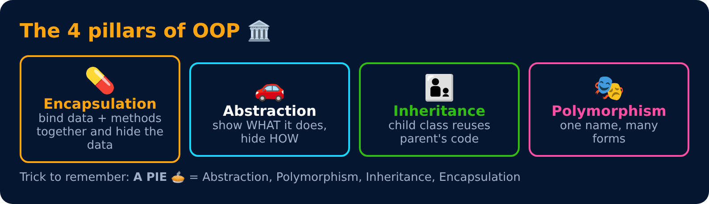

# OOPs in JavaScript (interview notes)



> Simple notes with pictures and runnable **JavaScript** (every program with an **Output** block was run on Node.js and its output checked).
> Every topic page has an **easy definition**, code, a **🧠 interview answer** you can say out loud and a **🎯 memory trick**.
> Each level ends with **🎯 top interview questions** + **🔁 quick revision** (answers hidden, so try first!). At the end, take the **🏁 Final Test**.

## Roadmap

```
Level 1 Basics ─▶ Level 2 Constructors ─▶ Level 3 Encapsulation & Abstraction
                                                        │
Level 6 Composition & Patterns ◀─ Level 5 Polymorphism ◀─ Level 4 Inheritance
          │
          ▼
Level 7 Under the Hood (prototypes, this, new) ─▶ 🏁 Final Test
```

## Contents

### [Level 1 : OOP Basics](level-1-basics/README.md) 🟩⬜⬜⬜⬜⬜⬜

What OOP is and why, classes & objects, properties & methods, `this`, objects in memory.

- [What is OOP & Why?](level-1-basics/01-what-is-oop.md)
- [Class, Object, Properties & Methods](level-1-basics/02-class-and-object.md)
- [The `this` Keyword (basics)](level-1-basics/03-this-keyword-basics.md)
- [Objects in Memory (references & garbage collection)](level-1-basics/04-objects-in-memory.md)
- 🎯 [Interview & revision questions](level-1-basics/interview-questions.md)

### [Level 2 : Constructors & Creating Objects](level-2-constructors/README.md) 🟩🟩⬜⬜⬜⬜⬜

Constructors & class fields, `new`, shallow vs deep copy, static, garbage collection & cleanup.

- [Constructors & Class Fields](level-2-constructors/01-constructors.md)
- [The `new` Keyword](level-2-constructors/02-new-keyword.md)
- [Shallow Copy vs Deep Copy](level-2-constructors/03-shallow-vs-deep-copy.md)
- [Static Members](level-2-constructors/04-static-members.md)
- [Garbage Collection & Cleanup](level-2-constructors/05-garbage-collection-and-cleanup.md)
- 🎯 [Interview & revision questions](level-2-constructors/interview-questions.md)

### [Level 3 : Encapsulation & Abstraction](level-3-encapsulation-abstraction/README.md) 🟩🟩🟩⬜⬜⬜⬜

The 4 pillars, encapsulation, access modifiers, getters & setters, abstraction & "abstract" classes.

- [The 4 Pillars of OOP](level-3-encapsulation-abstraction/01-four-pillars.md)
- [Encapsulation](level-3-encapsulation-abstraction/02-encapsulation.md)
- [Access Modifiers (public, `#private`, "protected")](level-3-encapsulation-abstraction/03-access-modifiers.md)
- [Getters & Setters](level-3-encapsulation-abstraction/04-getters-setters.md)
- [Abstraction](level-3-encapsulation-abstraction/05-abstraction.md)
- 🎯 [Interview & revision questions](level-3-encapsulation-abstraction/interview-questions.md)

### [Level 4 : Inheritance](level-4-inheritance/README.md) 🟩🟩🟩🟩⬜⬜⬜

`extends`, `super`, types of inheritance & mixins, constructor order.

- [Inheritance Basics](level-4-inheritance/01-inheritance-basics.md)
- [The `super` Keyword](level-4-inheritance/02-super-keyword.md)
- [Types of Inheritance & Mixins](level-4-inheritance/03-types-of-inheritance.md)
- [Constructor Order & the Init Trap](level-4-inheritance/04-constructor-order.md)
- 🎯 [Interview & revision questions](level-4-inheritance/interview-questions.md)

### [Level 5 : Polymorphism](level-5-polymorphism/README.md) 🟩🟩🟩🟩🟩⬜⬜

Overriding, duck typing, and why JS has no overloading.

- [Polymorphism Overview](level-5-polymorphism/01-polymorphism-overview.md)
- [Method Overriding](level-5-polymorphism/02-method-overriding.md)
- [Method Overloading (and why JS doesn't have it)](level-5-polymorphism/03-method-overloading.md)
- 🎯 [Interview & revision questions](level-5-polymorphism/interview-questions.md)

### [Level 6 : Composition, SOLID & Design Patterns](level-6-advanced/README.md) 🟩🟩🟩🟩🟩🟩⬜

Composition vs inheritance, has-a relationships, SOLID, Singleton/Factory/Observer, cheat sheet.

- [Composition & Relationships](level-6-advanced/01-composition-and-relationships.md)
- [SOLID Principles](level-6-advanced/02-solid-principles.md)
- [Design Patterns (Singleton, Factory, Observer)](level-6-advanced/03-design-patterns.md)
- [JS OOP Cheat Sheet](level-6-advanced/04-js-oop-cheat-sheet.md)
- 🎯 [Interview & revision questions](level-6-advanced/interview-questions.md)

### [Level 7 : Under the Hood](level-7-under-the-hood/README.md) 🟩🟩🟩🟩🟩🟩🟩

Full `this` rules & call/apply/bind, constructor functions & `new`, prototypes, classes under the hood, closures & freeze/seal, Symbols.

- [The `this` Keyword](level-7-under-the-hood/01-this-keyword.md)
- [Constructor Functions & the `new` Keyword](level-7-under-the-hood/02-constructor-functions-and-new.md)
- [Prototypes & the Prototype Chain](level-7-under-the-hood/03-prototypes.md)
- [ES6 Classes Under the Hood](level-7-under-the-hood/04-classes-under-the-hood.md)
- [Encapsulation Patterns](level-7-under-the-hood/05-encapsulation-patterns.md)
- [Symbols & Extending Built-ins](level-7-under-the-hood/06-symbols-and-built-ins.md)
- 🎯 [Interview questions, predict-the-output & polyfills](level-7-under-the-hood/interview-questions.md)

### [🏁 Final Test : Ask Yourself](final-test.md)

32 questions: explain-it, predict-the-output, and rapid fire.

## Most asked in interviews 🔥

4 pillars with real examples · class vs object · encapsulation vs abstraction · `#private` & getters/setters · `extends` & `super` · overriding vs overloading (and why JS has no overloading) · composition vs inheritance · prototype & prototype chain · `__proto__` vs `prototype` · what `new` does · `this` rules + call/apply/bind · arrow vs normal functions · class vs constructor function · closures for private data · shallow vs deep copy · `Object.freeze` vs `const` · SOLID (at least S and O) · implement an EventEmitter · polyfills for `bind` / `new` / `instanceof`
