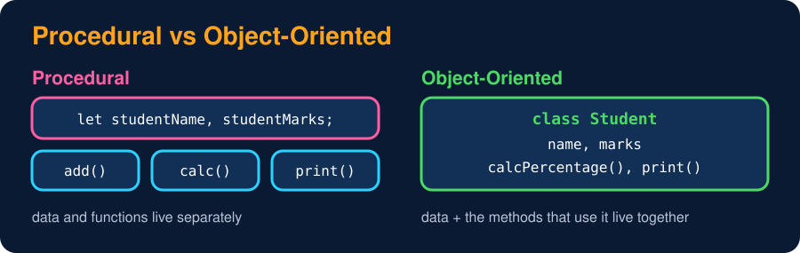

# What is OOP & Why?

<sub>Level 1 : OOP Basics</sub>

> **Easy definition:** OOP (Object-Oriented Programming) is a programming **paradigm** (a way of thinking and writing code) that **organizes code around classes and objects**.


```js
class Student {                       // class = the blueprint
  constructor(name) {
    this.name = name;                 // data
  }
  introduce() {                       // action
    console.log(`My name is ${this.name}`);
  }
}

const student1 = new Student("Gagan"); // object = a real thing made from the blueprint
student1.introduce();
```
**Output:**
```
My name is Gagan
```



## Why OOP? (procedural vs OOP)

OOP helps us **structure large programs** and improves **reusability**, **maintainability** and **data protection**.

### 1. Structure for large programs
Think of a school management system. Procedurally, it turns into a pile of unrelated variables and functions:

```js
let studentName, studentMarks;
function addStudent() {}
function calculateMarks() {}

let teacherName, teacherSubject;
function addTeacher() {}
function assignClass() {}
```
With OOP, related data and behaviour are grouped:
```js
class Student { constructor(name, marks) { this.name = name; this.marks = marks; } calculatePercentage() {} }
class Teacher { constructor(name, subject) { this.name = name; this.subject = subject; } assignClass() {} }
class Course  { constructor(name) { this.name = name; } enrollStudent(student) {} }
```

### 2. Reusability
Both styles reuse code. Procedural code reuses **functions**; OOP reuses **classes** (create many objects from one class) and extends them with **inheritance** and **composition**.

### 3. Maintainability
OOP makes code maintainable by organizing code into classes and objects, making it easier to **understand** and **modify**.

### 4. Data protection
```js
let balance = 1000;
balance = -5000;        // procedural: any code can change it 😬
```
```js
class BankAccount {
  #balance = 1000;                              // private: only the class can touch it
  deposit(amount) { if (amount > 0) this.#balance += amount; }
  getBalance() { return this.#balance; }
}
const account = new BankAccount();
account.deposit(500);
console.log(account.getBalance());
// account.#balance = -5000;  ❌ SyntaxError
```
**Output:**
```
1500
```

## 🧠 Interview answer

> **"OOP stands for Object-Oriented Programming. It is a programming paradigm that organizes code around classes and objects. It helps us structure large programs and improves reusability, maintainability and data protection. Its four pillars are encapsulation, abstraction, inheritance and polymorphism. JavaScript supports OOP through prototypes, and the ES6 `class` syntax is built on top of them."**

## 🎯 Memory trick

> **A Pie (Abstraction, Polymorphism, Inheritance, Encapsulation)**

---
[Level 1](README.md) · [Home](../README.md) · [Class, Object, Properties & Methods →](02-class-and-object.md)
