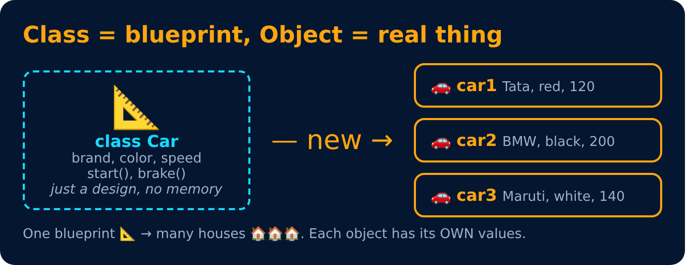
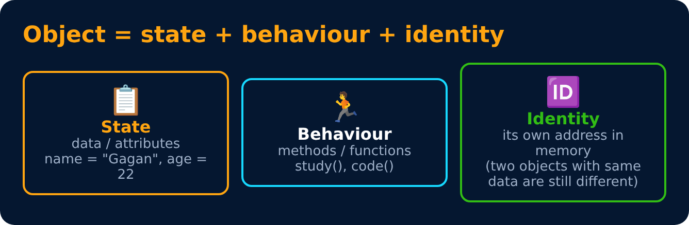

# Class, Object, Properties & Methods

<sub>Level 1 : OOP Basics</sub>

> **Class:** a blueprint or template used to create objects. It defines the properties and methods the objects will have.

> **Object:** an instance of a class that holds its own data and can use the methods defined by the class.



```js
class Car {
  constructor(brand, speed) {
    this.brand = brand;      // properties (data)
    this.speed = speed;
  }
  drive() {                  // method (stored once on Car.prototype, shared)
    console.log(`${this.brand} is driving at ${this.speed} km/h`);
  }
}

const c1 = new Car("Tata", 120);   // object 1
const c2 = new Car("BMW", 200);    // object 2
c1.drive();
c2.drive();
```
**Output:**
```
Tata is driving at 120 km/h
BMW is driving at 200 km/h
```

## Properties & methods

> **Properties → what an object HAS** (its data / state: the current values at a given moment)

> **Methods → what an object DOES** (its behaviour / actions)

```js
class Student {
  constructor(name) {
    this.name = name;                 // property
  }
  study() {                           // method
    console.log(`${this.name} is studying`);
  }
}

const s = new Student("Gagan");
s.study();
s.city = "Delhi";                     // JS objects are dynamic: add a property any time
```
**Output:**
```
Gagan is studying
```



Every object has **state** (property values), **behaviour** (methods) and **identity** (it's a separate object, even if another one has the same values: `{a:1} === {a:1}` is `false`).

## 🧠 Interview answer

> **"A class is a blueprint that defines the properties and behaviours of objects. An object is an actual instance of a class. For example, `Student` can be a class with a property `name` and a method `study()`; we can create many objects like `s1` and `s2` from it, and each has its own data. In JavaScript a class is actually a special function, and objects can also be created directly with object literals."**

## 🎯 Memory trick

> **Class = cookie cutter 🍪, object = the cookie. Properties = what it HAS, methods = what it DOES.**

---
[← What is OOP & Why?](01-what-is-oop.md) · [Level 1](README.md) · [Home](../README.md) · [The this Keyword (basics) →](03-this-keyword-basics.md)
