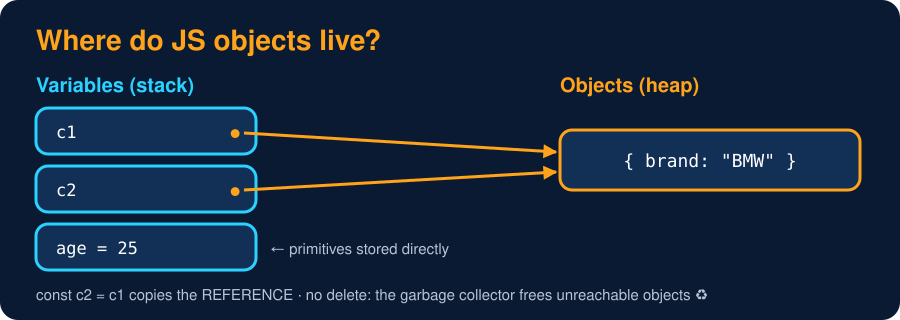

# Objects in Memory

<sub>Level 1 : OOP Basics</sub>

> **Easy definition:** primitives (numbers, strings, booleans...) are stored **by value**. Objects live in the **heap**, and variables only hold a **reference** (an arrow) to them.



```js
const c1 = { brand: "Tata" };
const c2 = c1;            // copies the REFERENCE, not the object
c2.brand = "BMW";
console.log(c1.brand);    // both names point to the same heap object
console.log(c1 === c2);
console.log({ a: 1 } === { a: 1 });   // different objects, even with same content
```
**Output:**
```
BMW
true
false
```

## Primitives vs objects

```js
let a = 10;
let b = a;          // copies the VALUE
b = 20;
console.log(a, b);

function rename(user) { user.name = "Changed"; }   // gets a copy of the REFERENCE
const u = { name: "Gagan" };
rename(u);
console.log(u.name);
```
**Output:**
```
10 20
Changed
```

| | Primitives | Objects (incl. arrays, functions, class instances) |
|---|---|---|
| stored | by value | in the heap, variable holds a reference |
| `b = a` | independent copy | both point to the **same** object |
| `===` compares | values | references (same object?) |
| passed to a function | copy of the value | copy of the reference (function can change the object) |

## Who frees the memory?

There is **no `delete obj`** for objects and no manual memory management. The **garbage collector** (mark-and-sweep) automatically frees an object once nothing can reach it any more:

```js
let user = { name: "Gagan" };
user = null;        // nothing points to the object now → GC will free it later
```
More in [Garbage Collection & Cleanup](../level-2-constructors/05-garbage-collection-and-cleanup.md).

> React connection: `setState(sameObject)` after mutating it doesn't re-render, because the **reference** didn't change. That's why we create new objects/arrays (`{...obj}`, `[...arr]`).

## 🧠 Interview answer

> **"In JavaScript, primitives are copied by value, while objects are stored in the heap and variables hold references to them. Assigning an object to another variable copies the reference, so both variables point to the same object, and `===` checks whether two references point to the same object. Memory is freed automatically by the garbage collector when an object is no longer reachable."**

## 🎯 Memory trick

> **A variable holding an object is a remote control 🎮, not the TV. Copy the remote → still one TV.**

---
[← The this Keyword (basics)](03-this-keyword-basics.md) · [Level 1](README.md) · [Home](../README.md) · [Level 1 : Interview & Revision Questions →](interview-questions.md)
