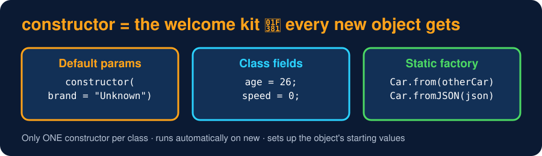

# Constructors & Class Fields

<sub>Level 2 : Constructors & Creating Objects</sub>

> **Easy definition:** a **constructor** is a special method that **runs automatically when an object is created** with `new`. It is mainly used to **initialize the object's properties**.



```js
class Student {
  constructor(name, age) {
    console.log("constructor runs for", name);
    this.name = name;
    this.age = age;
  }
}

const student = new Student("Gagan", 25);   // constructor is called automatically
console.log(student.name, student.age);
```
**Output:**
```
constructor runs for Gagan
Gagan 25
```

## Class fields (direct properties)

Properties can also be written **directly inside the class**, without a constructor. Useful for **default values** that every object starts with.

```js
class Student {
  age = 26;                       // class field: same starting value for every object
  constructor(name) {
    this.name = name;             // value that differs per object
  }
}

const s1 = new Student("gagan");
const s2 = new Student("pawan");
console.log(s1.name, s1.age);
console.log(s2.name, s2.age);
```
**Output:**
```
gagan 26
pawan 26
```
Fields are created **before** the constructor body runs, and each object gets its own copy.

## One constructor only → how to get "many"

Some languages let you write several constructors (overloading). JavaScript allows **only one** per class (`SyntaxError: A class may only have one constructor`). Use **default parameters** and **static factory methods** instead:

```js
class Car {
  // ONE constructor only. Default parameters give "default + parameterized" in one.
  constructor(brand = "Unknown", speed = 0) {
    this.brand = brand;
    this.speed = speed;
  }
  // No copy constructor in JS → write a static "copy" factory
  static from(other) {
    return new Car(other.brand, other.speed);
  }
}

const a = new Car();              // like default
const b = new Car("BMW", 200);    // like parameterized
const c = Car.from(b);            // like copy (a NEW object)
const d = b;                      // ⚠️ NOT a copy: same object, two names
d.speed = 250;

console.log(a.brand, a.speed);
console.log(c.brand, c.speed);    // unaffected by d.speed = 250
console.log(b.speed, b === d, b === c);
```
**Output:**
```
Unknown 0
BMW 200
250 true false
```
Another common style for many optional values is an **options object**: `new Car({ brand: "BMW", speed: 200 })` with `constructor({ brand = "Unknown", speed = 0 } = {})`.

## Rules to remember

| Rule | Detail |
|---|---|
| name | always `constructor` |
| how many | one per class |
| when it runs | automatically on `new ClassName()` |
| no constructor written | JS adds an empty one: `constructor() {}` (in a child class: `constructor(...args) { super(...args); }`) |
| calling a class without `new` | `TypeError: Class constructor Car cannot be invoked without 'new'` |
| return value | normally none. If it returns an **object**, `new` gives that object instead (a primitive return is ignored) |
| in a child class | must call `super()` before using `this` ([Level 4](../level-4-inheritance/02-super-keyword.md)) |

## Constructor vs normal method

| Constructor | Normal method |
|---|---|
| runs **automatically** on `new` | runs only when **you call it** (`s.study()`) |
| sets up the object's starting state | does some work with the object |
| only one, named `constructor` | any number, any names |

## 🧠 Interview answer

> **"A constructor is a special method that runs automatically when an object is created with `new`, and it's mainly used to initialize the object's properties. A JavaScript class can have only one constructor, so we use default parameters, an options object or static factory methods to create objects in different ways. Properties can also be declared directly as class fields, which is handy for default values."**

## 🎯 Memory trick

> **Constructor = the welcome kit 🎁 every new object gets at birth.**

---
[← Level 1 : Interview & Revision Questions](../level-1-basics/interview-questions.md) · [Level 2](README.md) · [Home](../README.md) · [The new Keyword →](02-new-keyword.md)
