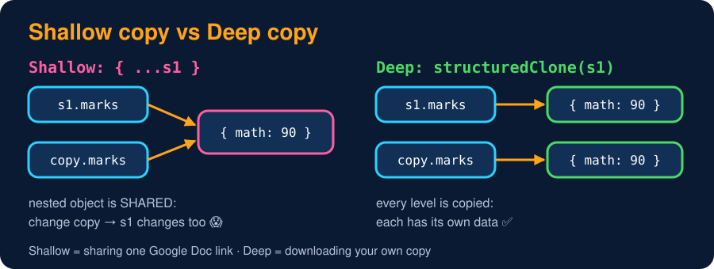

# Shallow Copy vs Deep Copy

<sub>Level 2 : Constructors & Creating Objects</sub>

> **Shallow copy:** copies only the **top level**. Nested objects/arrays are still **shared** between the original and the copy.
> **Deep copy:** copies **every level**, so the copy is fully independent.



```js
const s1 = { name: "Gagan", marks: { math: 90 } };

const shallow = { ...s1 };          // or Object.assign({}, s1)
const deep = structuredClone(s1);   // built-in deep copy

shallow.name = "Ravi";              // top level → independent
shallow.marks.math = 50;            // nested object → SHARED with s1!

console.log(s1.name, s1.marks.math);
console.log(deep.marks.math);
```
**Output:**
```
Gagan 50
90
```

## All the ways to copy

| Way to copy | Depth | Gotchas |
|---|---|---|
| `b = a` | no copy at all | same object |
| `{ ...a }`, `Object.assign({}, a)`, `[...arr]`, `arr.slice()` | shallow | nested objects shared |
| `JSON.parse(JSON.stringify(a))` | deep | loses functions and `undefined`, `Date` → string, `Map`/`Set` → `{}`, crashes on circular references |
| `structuredClone(a)` | deep | handles Date/Map/Set/circular refs, but no functions and **class instances become plain objects** (`instanceof` → false) |
| `_.cloneDeep(a)` (lodash) / your own recursive function | deep | most control |

## Copying class instances

`structuredClone` drops the class, so give the class its own copy method:

```js
class Student {
  constructor(name, marks) { this.name = name; this.marks = marks; }
  clone() { return new Student(this.name, { ...this.marks }); }   // copy nested data yourself
}

const a = new Student("Gagan", { math: 90 });
const b = a.clone();
b.marks.math = 10;
console.log(a.marks.math, b instanceof Student, structuredClone(a) instanceof Student);
```
**Output:**
```
90 true false
```

## Write your own deep copy (asked in interviews)

```js
function deepCopy(value) {
  if (value === null || typeof value !== "object") return value;   // primitives
  const copy = Array.isArray(value) ? [] : {};
  for (const key of Object.keys(value)) copy[key] = deepCopy(value[key]);
  return copy;
}

const original = { a: 1, list: [1, 2], inner: { b: 2 } };
const copy = deepCopy(original);
copy.list.push(3);
copy.inner.b = 99;
console.log(original.list, original.inner.b);
```
**Output:**
```
[ 1, 2 ] 2
```
(Doesn't handle Dates, Maps or circular references; mention that in the interview.)

> React tip: state updates like `setUser({ ...user, address: { ...user.address, city } })` copy level by level, so React sees **new references** and re-renders.

## 🧠 Interview answer

> **"A shallow copy copies only the top-level properties, so nested objects are still shared, which is what spread and `Object.assign` do. A deep copy copies every level so the copy is completely independent; in modern JavaScript we use `structuredClone`, or `JSON.parse(JSON.stringify())` for simple data, keeping its limitations in mind."**

## 🎯 Memory trick

> **Shallow = sharing one Google Doc link. Deep = downloading your own copy.**

---
[← The new Keyword](02-new-keyword.md) · [Level 2](README.md) · [Home](../README.md) · [Static Members →](04-static-members.md)
