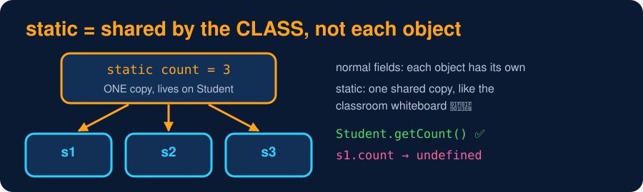

# Static Members

<sub>Level 2 : Constructors & Creating Objects</sub>

> **Easy definition:** a `static` property or method belongs to the **class itself**, not to each object. There is **one shared copy**, and you use it through the class name.



```js
class Student {
  static count = 0;                 // one copy, stored on the class itself
  constructor() { Student.count++; }
  static getCount() { return this.count; }   // inside a static method, this = the class
}

new Student(); new Student(); new Student();
console.log(Student.getCount());    // no object needed
console.log(new Student().count);   // undefined: instances don't see statics
```
**Output:**
```
3
undefined
```

## When to use static

- **Counters / shared settings** for all objects (`Student.count`, `Config.apiUrl`).
- **Utility functions** that don't need an object: `Math.max()`, `Number.isInteger()`, `Object.keys()`, `Array.from()`, `Promise.all()`.
- **Factory methods** that create objects: `Car.from(other)`, `User.fromJSON(json)`.

## More static features

```js
class Config {
  static #secretKey = "abc123";                   // private static
  static settings;
  static {                                        // static block: runs ONCE when the class is defined
    Config.settings = { env: "prod", retries: 3 };
  }
  static hasKey() { return Config.#secretKey.length > 0; }
}
class TestConfig extends Config {}

console.log(Config.settings.env, Config.hasKey());
console.log(TestConfig.settings.retries);         // statics are inherited by child classes
```
**Output:**
```
prod true
3
```

| | Instance member | Static member |
|---|---|---|
| belongs to | each object | the class |
| copies | one per object | one in total |
| access | `obj.name` | `ClassName.count` |
| `this` inside a method | the object | the class |
| can read instance data? | yes | no (there's no object), unless you pass one in |

## 🧠 Interview answer

> **"Static properties and methods belong to the class itself rather than to its instances. There's only one shared copy, and they're accessed through the class name, like `Math.max()` or `Array.from()`. They're used for shared data, utility functions and factory methods. In JavaScript, static members are also inherited by child classes."**

## 🎯 Memory trick

> **static = the classroom whiteboard 🧑‍🏫: one board, every student sees the same thing.**

---
[← Shallow Copy vs Deep Copy](03-shallow-vs-deep-copy.md) · [Level 2](README.md) · [Home](../README.md) · [Garbage Collection & Cleanup →](05-garbage-collection-and-cleanup.md)
