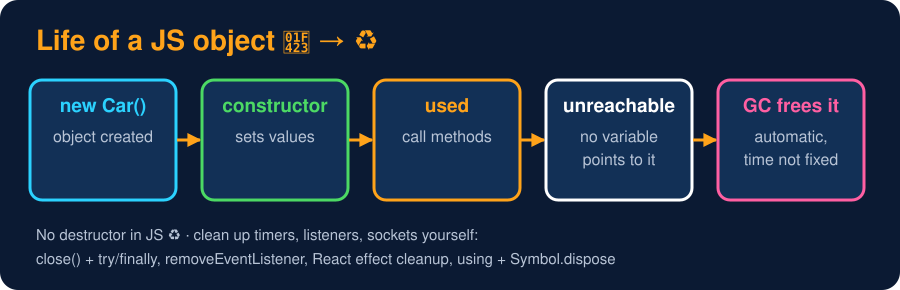

# Garbage Collection & Cleanup

<sub>Level 2 : Constructors & Creating Objects</sub>

> **Easy definition:** JavaScript has **no destructors**. The **garbage collector (GC)** automatically frees an object's memory once **nothing can reach it** any more. Other resources (timers, listeners, connections) you must clean up yourself.



## How the GC decides (mark-and-sweep)

1. Start from the **roots**: global variables and the variables of functions currently running.
2. **Mark** every object reachable from them (following references).
3. **Sweep** (free) everything that wasn't marked.

```js
let user = { name: "Gagan" };
let admin = user;     // two references
user = null;          // still reachable through admin → NOT freed
admin = null;         // unreachable now → GC will free it (you can't control when)
```
Reachability is what counts, not a reference count, so two objects pointing at each other but unreachable from the roots are still freed.

## Cleanup is your job

Memory is automatic, but the GC doesn't close files, stop timers or remove event listeners.

**1. Classic way: a `close()` / `dispose()` method + `try...finally`**
```js
class FileReader {
  constructor(name) { this.name = name; console.log("open " + name); }
  close() { console.log("close " + this.name); }
}

const f = new FileReader("data.txt");
try {
  console.log("reading...");
  throw new Error("disk error");
} catch (e) {
  console.log("error:", e.message);
} finally {
  f.close();                   // always runs → guaranteed cleanup
}
```
**Output:**
```
open data.txt
reading...
error: disk error
close data.txt
```

**2. Modern way: `using` + `Symbol.dispose`** (Explicit Resource Management; works in recent Node and Chrome). The object is cleaned up automatically at the end of the block, the closest thing JS has to a destructor:
```js
class Box {
  constructor(name) { this.name = name; console.log("made " + name); }
  [Symbol.dispose]() { console.log("destroyed " + this.name); }   // cleanup hook
}

{
  using a = new Box("A");      // `using` = dispose automatically at end of block
  using b = new Box("B");
  console.log("end of block");
}                              // b disposed first, then a (reverse order)
```
**Output:**
```
made A
made B
end of block
destroyed B
destroyed A
```

**3. In React:** return a cleanup function from `useEffect`:
```js
useEffect(() => {
  const id = setInterval(tick, 1000);
  window.addEventListener("resize", onResize);
  return () => {                       // runs when the component unmounts
    clearInterval(id);
    window.removeEventListener("resize", onResize);
  };
}, []);
```

## Common memory leaks in frontend JS (interview favourite)

- event listeners never removed, `setInterval` never cleared
- `useEffect` without a cleanup function
- accidental global variables (forgetting `let`/`const` in sloppy mode)
- caches/arrays that only grow, detached DOM nodes still referenced in JS
- closures that keep large objects alive longer than needed

> 💡 `WeakMap`, `WeakSet` and `WeakRef` hold objects **weakly**, so they don't stop the GC from freeing them, which is great for caches keyed by objects. `FinalizationRegistry` can run a callback after an object is collected, but timing isn't guaranteed, so never use it for important cleanup.

## 🧠 Interview answer

> **"JavaScript has no destructors; memory is managed by the garbage collector, which uses mark-and-sweep to free objects that are no longer reachable from the roots. Non-memory resources such as timers, event listeners or connections must be cleaned up manually, for example with a `close()` method in `try...finally`, a React effect cleanup, or the newer `using` declarations with `Symbol.dispose`."**

## 🎯 Memory trick

> **GC = the cleaner ♻️ who throws away anything nobody is holding. But you still have to turn off the taps (timers, listeners) yourself.**

---
[← Static Members](04-static-members.md) · [Level 2](README.md) · [Home](../README.md) · [Level 2 : Interview & Revision Questions →](interview-questions.md)
