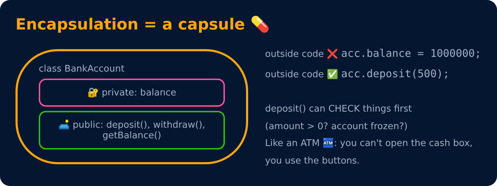

# Encapsulation

<sub>Level 3 : Encapsulation & Abstraction</sub>

> **Easy definition:** **Encapsulation** = bundling data and the methods that work on that data inside one unit (a class), **and controlling access** to that data.



```js
class BankAccount {
  #balance = 0;                         // hidden

  deposit(amt) {
    if (amt <= 0) { console.log("Invalid amount"); return; }
    this.#balance += amt;
  }
  withdraw(amt) {
    if (amt > this.#balance) { console.log("Insufficient balance"); return false; }
    this.#balance -= amt; return true;
  }
  get balance() { return this.#balance; }   // getter: read like a property, no setter = read-only
}

const acc = new BankAccount();
acc.deposit(1000);
acc.deposit(-50);
acc.withdraw(5000);
console.log(acc.balance);       // no () needed
acc.balance = 99;               // no setter → ignored (TypeError in strict mode)
console.log(acc.balance);
```
**Output:**
```
Invalid amount
Insufficient balance
1000
1000
```
Here:
- `#balance` → **private data**: `acc.#balance = 5000` outside the class is a `SyntaxError`.
- `deposit()` / `withdraw()` → the **controlled** way to change it (with validation).
- `get balance` → the controlled way to read it.

## Why encapsulate?

- **Data protection**: nobody can set `balance = -100` by mistake.
- **Validation in one place**: every change goes through `deposit()` / `withdraw()`.
- **Freedom to change internals**: store the balance in paise, add logging, cache it... outside code doesn't break.

> **Data hiding** (making things private) is *part* of encapsulation. Encapsulation = bundling + controlling access.

## Encapsulation without classes: closures

Before `#private` existed (2022), JS hid data inside functions. You'll still see this everywhere, and React hooks work this way too:

```js
function createAccount() {
  let balance = 0;                       // private: only the inner functions can see it
  return {
    deposit(amt) { if (amt > 0) balance += amt; },
    getBalance() { return balance; },
  };
}

const acc = createAccount();
acc.deposit(500);
console.log(acc.getBalance(), acc.balance);   // 500 undefined
```
**Output:**
```
500 undefined
```
More ways (module pattern, `WeakMap`, `Object.freeze`, property descriptors) in [Level 7: Encapsulation patterns](../level-7-under-the-hood/05-encapsulation-patterns.md).

> React connection: a component's `useState` value is encapsulated; other components can only change it through the setter/callbacks you pass down as props.

## 🧠 Interview answer

> **"Encapsulation is the practice of bundling data and the methods that operate on it inside a class, and controlling access to that data. In JavaScript we make fields private with `#` and expose controlled access through methods or getters and setters, which lets us validate changes and change the internal implementation without breaking outside code. Closures are another way to achieve it."**

## 🎯 Memory trick

> **Encapsulation = a capsule 💊 / an ATM 🏧: you can't open the cash box, you use the buttons.**

---
[← The 4 Pillars of OOP](01-four-pillars.md) · [Level 3](README.md) · [Home](../README.md) · [Access Modifiers →](03-access-modifiers.md)
