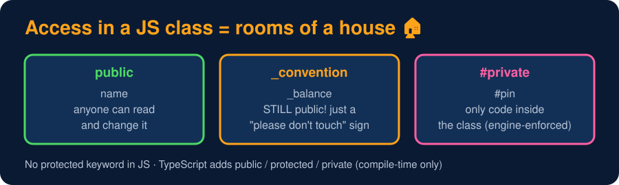

# Access Modifiers

<sub>Level 3 : Encapsulation & Abstraction</sub>

> **Easy definition:** access modifiers control **who can access** the properties and methods of a class. JavaScript has two native levels: **public** (default) and **private** (`#`). There is **no native `protected`**.



```js
class Account {
  #pin = 1234;          // truly private (ES2022): only code inside Account can see it
  _balance = 500;       // "protected" by CONVENTION only - still accessible outside!
  holder = "Gagan";     // public

  show() { console.log(this.holder, this._balance, this.#pin); }  // inside: all OK
}

const a = new Account();
console.log(a.holder);      // ✅ public
console.log(a._balance);    // ⚠️ works - the underscore is just a hint to other devs
// console.log(a.#pin);     // ❌ SyntaxError: Private field '#pin' must be declared in an enclosing class
console.log(a.pin);         // undefined (#pin and pin are different names)
a.show();
```
**Output:**
```
Gagan
500
undefined
Gagan 500 1234
```

## Private methods too

```js
class User {
  #password;
  constructor(password) { this.#password = password; }
  #hash(text) { return [...text].reverse().join(""); }     // private method
  login(attempt) { return this.#hash(attempt) === this.#hash(this.#password); }
}

const u = new User("secret");
console.log(u.login("secret"), u.login("guess"), typeof u.hash);
```
**Output:**
```
true false undefined
```

## `#private` and child classes

`#private` members are visible **only inside the class that declares them**, not even in child classes. That's why people use `_name` when they want something "for the class and its children":

```js
class Animal {
  #secret = "hidden";
  _family = "mammal";                 // "protected" by convention
}
class Dog extends Animal {
  info() { return this._family; }     // ✅ works
  // peek() { return this.#secret; }  // ❌ SyntaxError: #secret is not declared in Dog
}
console.log(new Dog().info());
```
**Output:**
```
mammal
```

## Comparison

| Level | Syntax | Inside class | Child class | Outside |
|---|---|---|---|---|
| Public | `name` | ✅ | ✅ | ✅ |
| "Protected" (convention) | `_name` | ✅ | ✅ | ✅ (just a hint) |
| Private | `#name` | ✅ | ❌ | ❌ |

> **TypeScript** adds `public`, `protected` and `private` keywords, but they're checked only at **compile time** and disappear in the JavaScript output. `#private` is enforced by the JS engine at run time.

## 🧠 Interview answer

> **"JavaScript class members are public by default. We use `#` for truly private fields and methods, which can only be accessed inside the class that declares them, not even by child classes. JavaScript has no built-in `protected`; developers use an underscore prefix as a convention, or TypeScript's `protected`, which is only checked at compile time."**

## 🎯 Memory trick

> **public = drawing room 🛋️ (anyone), `_name` = a "please knock" sign 🚪 (still open), `#name` = your locker 🔐 (only you).**

---
[← Encapsulation](02-encapsulation.md) · [Level 3](README.md) · [Home](../README.md) · [Getters & Setters →](04-getters-setters.md)
