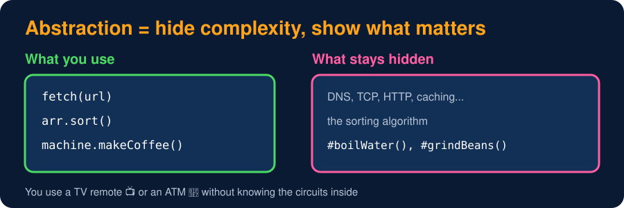
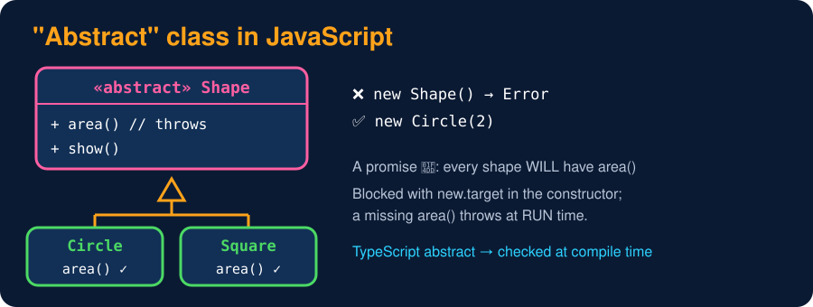
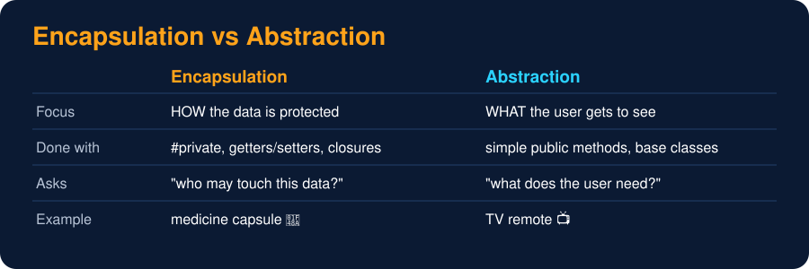

# Abstraction

<sub>Level 3 : Encapsulation & Abstraction</sub>

> **Easy definition:** **Abstraction** = hiding unnecessary implementation details and showing only the **essential functionality** to the user.



```js
class CoffeeMachine {
  makeCoffee() {                         // the ONLY thing the user needs
    this.#boilWater();
    this.#grindBeans();
    console.log("Coffee ready! ☕");
  }
  #boilWater() { console.log("Boiling water..."); }
  #grindBeans() { console.log("Grinding beans..."); }
}

const machine = new CoffeeMachine();
machine.makeCoffee();
```
**Output:**
```
Boiling water...
Grinding beans...
Coffee ready! ☕
```
The user just calls `machine.makeCoffee()` and doesn't need to know how boiling or grinding works.

**Real-life example:** an ATM shows *Enter PIN → Enter amount → Withdraw*, and hides PIN verification, transaction processing and database updates.
**Everyday JS:** `fetch(url)`, `array.sort()`, `localStorage.setItem()`, a custom hook like `useAuth()`.

## "Abstract classes" in JavaScript

An **abstract class** is a base class that is only a *concept* (`Shape`, `Payment`): it should never be created directly, and it forces children to implement certain methods. JS has no `abstract` keyword, so we use **`new.target`** (the class `new` was called on) and methods that **throw**:



```js
class Shape {                                   // "abstract" class
  constructor() {
    if (new.target === Shape) throw new Error("Shape is abstract, can't create it");
  }
  area() {                                      // "abstract" method
    throw new Error(`${this.constructor.name} must implement area()`);
  }
  show() { console.log(`Area = ${this.area()}`); }
}

class Circle extends Shape {
  constructor(r) { super(); this.r = r; }
  area() { return 3.14 * this.r * this.r; }
}
class Square extends Shape {
  constructor(s) { super(); this.s = s; }
  area() { return this.s * this.s; }
}
class Blob extends Shape {}                     // forgot area()

[new Circle(2), new Square(3)].forEach(s => s.show());
try { new Shape(); } catch (e) { console.log(e.message); }
try { new Blob().show(); } catch (e) { console.log(e.message); }
```
**Output:**
```
Area = 12.56
Area = 9
Shape is abstract, can't create it
Blob must implement area()
```
⚠️ These errors appear at **run time**. **TypeScript** checks them at compile time:
```ts
abstract class Shape {
  abstract area(): number;                          // must be implemented
  show() { console.log(`Area = ${this.area()}`); }
}
interface Flyable { fly(): void; }                  // interface = shape of an object, erased at runtime
class Bird extends Shape implements Flyable {
  area() { return 0; }
  fly() { console.log("flying"); }
}
```

## Interfaces & duck typing

An **interface** is a contract: "anything that can fly must have `fly()`". Plain JS has no `interface` keyword; it uses **duck typing**: *if it walks like a duck and quacks like a duck, it's a duck.* Any object with a `fly()` method can be used where something "Flyable" is expected. TypeScript adds real `interface`s.

| | Abstract class | Interface (TypeScript) |
|---|---|---|
| has code | yes, shared methods + abstract ones | no, only the shape (method/property types) |
| how many per class | `extends` one | `implements` many |
| exists at run time | yes | no (erased) |
| meaning | "is-a" with shared code | "can-do" ability (`Flyable`, `Printable`) |

## Encapsulation vs Abstraction



> **Encapsulation** → bundles data and methods and **controls access** (how to protect).
> **Abstraction** → **hides details** and exposes only what's needed (what to show).

## 🧠 Interview answer

> **"Abstraction means hiding internal implementation details and exposing only the essential functionality to the user, like a coffee machine's single `makeCoffee()` button. In JavaScript we achieve it with simple public methods and private helpers, base classes that can't be instantiated directly using `new.target`, and in TypeScript with `abstract` classes and interfaces. Abstraction focuses on what to show, while encapsulation focuses on how to protect and access the data."**

## 🎯 Memory trick

> **Abstraction = TV remote 📺: you press the buttons, you never see the circuits.**

---
[← Getters & Setters](04-getters-setters.md) · [Level 3](README.md) · [Home](../README.md) · [Level 3 : Interview & Revision Questions →](interview-questions.md)
