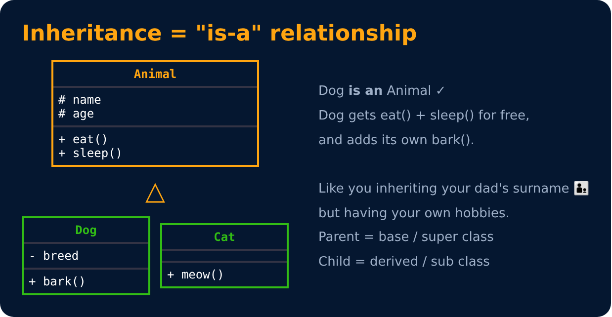
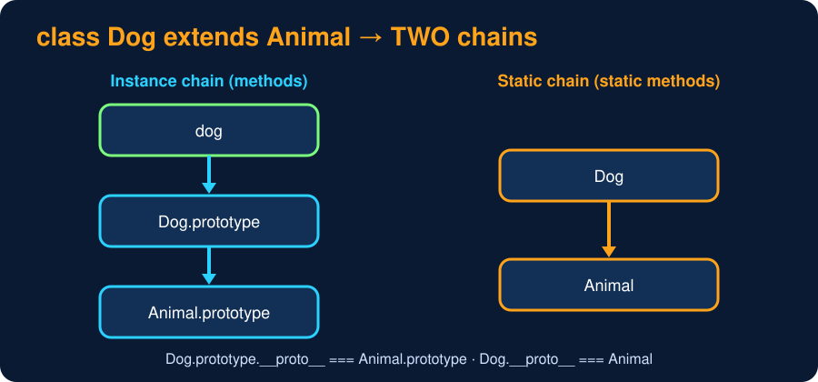

# Inheritance Basics

<sub>Level 4 : Inheritance</sub>

> **Easy definition:** **Inheritance** lets one class (the **child**) reuse the properties and methods of another class (the **parent**). The child gets the parent's features and can add its own. In JS we use the `extends` keyword.



```js
class Animal {
  constructor(name) { this.name = name; }
  eat() { console.log(`${this.name} is eating`); }
}

class Dog extends Animal {               // Dog inherits Animal
  constructor(name) { super(name); }     // call parent constructor (must be before using this)
  bark() { console.log(`${this.name} says Woof!`); }
}

const d = new Dog("Tommy");
d.eat();     // inherited from Animal
d.bark();    // Dog's own
console.log(d instanceof Dog, d instanceof Animal);
console.log(Object.getPrototypeOf(Dog.prototype) === Animal.prototype);   // extends = prototype link
```
**Output:**
```
Tommy is eating
Tommy says Woof!
true true
true
```
```text
Animal (parent / base / super class)
  ↓ extends
 Dog   (child / derived / sub class)
```

## Why use inheritance?

Without it, common code gets repeated:
```js
class Dog { eat() { console.log("Eating"); } bark() { console.log("Barking"); } }
class Cat { eat() { console.log("Eating"); } meow() { console.log("Meowing"); } }   // eat() written twice
```
With it, `eat()` is written once and reused:
```js
class Animal { eat() { console.log("Eating"); } }
class Dog extends Animal { bark() { console.log("Barking"); } }
class Cat extends Animal { meow() { console.log("Meowing"); } }
```

- **Reuse code** and avoid repetition
- Build an **is-a** relationship: a Dog **is an** Animal
- Makes **polymorphism** possible (Level 5): treat Dogs and Cats as Animals

## How it works in JS

- `extends` doesn't copy anything. It **links prototypes**: when `d.eat` isn't found on `d` or `Dog.prototype`, JS looks in `Animal.prototype` (the **prototype chain**, see [Level 7](../level-7-under-the-hood/03-prototypes.md)).
- A child can **add** new methods (`bark`) and **override** parent ones (Level 5).
- `static` methods are inherited too (`Dog.someStatic()` works).
- `#private` fields of the parent are **not** accessible in the child.
- You can extend built-ins: `class ValidationError extends Error`, `class Stack extends Array`.



## 🧠 Interview answer

> **"Inheritance is an OOP feature that allows a child class to acquire and reuse the properties and methods of a parent class, creating an is-a relationship. In JavaScript we use `extends`, which links the child's prototype to the parent's prototype, so methods not found on the child are looked up on the parent."**

## 🎯 Memory trick

> **Inheritance = child gets features from parent 👨‍👦, like your dad's surname plus your own hobbies.**

---
[← Level 3 : Interview & Revision Questions](../level-3-encapsulation-abstraction/interview-questions.md) · [Level 4](README.md) · [Home](../README.md) · [The super Keyword →](02-super-keyword.md)
