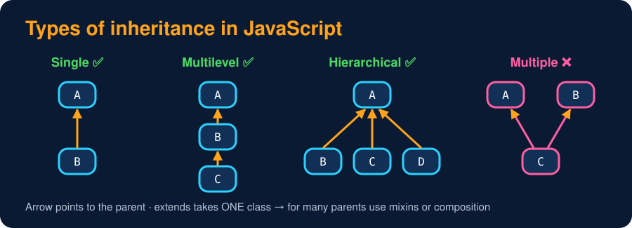

# Types of Inheritance & Mixins

<sub>Level 4 : Inheritance</sub>



```js
class Animal { eat() { return "eating"; } }

class Dog extends Animal { bark() { return "barking"; } }      // 1. Single:       Animal → Dog
class Puppy extends Dog { play() { return "playing"; } }       // 2. Multilevel:   Animal → Dog → Puppy
class Cat extends Animal { meow() { return "meowing"; } }      // 3. Hierarchical: Dog and Cat share Animal

const p = new Puppy();
console.log(p.eat(), p.bark(), p.play());        // Puppy gets features from Dog AND Animal
console.log(new Cat().eat());
```
**Output:**
```
eating barking playing
eating
```

| Type | Structure | JavaScript |
|---|---|---|
| **Single** | one parent → one child | ✅ `class B extends A` |
| **Multilevel** | parent → child → grandchild | ✅ `class C extends B` |
| **Hierarchical** | one parent → many children | ✅ `B extends A`, `C extends A` |
| **Multiple** | many parents → one child | ❌ `class Dog extends Animal, Pet {}` is a **SyntaxError** |
| **Hybrid** | a mix of the above | ❌ directly (needs multiple) |

Because every object has exactly **one** prototype, the chain is always a single line, so JavaScript has **no diamond problem** (the ambiguity languages with multiple inheritance face when two parents share a grandparent).

## "Multiple inheritance" the JS way: mixins

A **mixin** adds a set of methods to a class without being its parent.

**Style 1: copy methods with `Object.assign`**
```js
const canEat  = { eat()  { return `${this.name} eats`; } };
const canSwim = { swim() { return `${this.name} swims`; } };

class Fish { constructor(name) { this.name = name; } }
Object.assign(Fish.prototype, canEat, canSwim);     // copy methods onto the prototype

const nemo = new Fish("Nemo");
console.log(nemo.eat(), "|", nemo.swim());
```
**Output:**
```
Nemo eats | Nemo swims
```

**Style 2: class-factory mixins** (a function that takes a class and returns a bigger class)
```js
// A mixin = a function that takes a class and returns a bigger class
const CanFly  = Base => class extends Base { fly()  { return `${this.name} flies`; } };
const CanSwim = Base => class extends Base { swim() { return `${this.name} swims`; } };

class Animal { constructor(name) { this.name = name; } }
class Duck extends CanSwim(CanFly(Animal)) {}      // Animal → CanFly → CanSwim → Duck

const d = new Duck("Donald");
console.log(d.fly(), "|", d.swim());
console.log(d instanceof Animal);
```
**Output:**
```
Donald flies | Donald swims
true
```
If two mixins define the same method name, the one applied **last** (closest to `Duck`) wins.

Often the simplest answer is **composition** instead: a `Duck` *has* a flying ability and a swimming ability ([Level 6](../level-6-advanced/01-composition-and-relationships.md)).

## 🧠 Interview answer

> **"JavaScript supports single, multilevel and hierarchical inheritance through classes, but not multiple inheritance, because `extends` accepts only one parent. To combine features from several sources we use mixins or composition. Since every object has a single prototype chain, JavaScript doesn't have the diamond problem."**

## 🎯 Memory trick

> **Single → one parent, one child · Multilevel → grandpa → dad → you · Hierarchical → one parent, many kids · Multiple → ❌ in JS, use mixins.**

---
[← The super Keyword](02-super-keyword.md) · [Level 4](README.md) · [Home](../README.md) · [Constructor Order & the Init Trap →](04-constructor-order.md)
