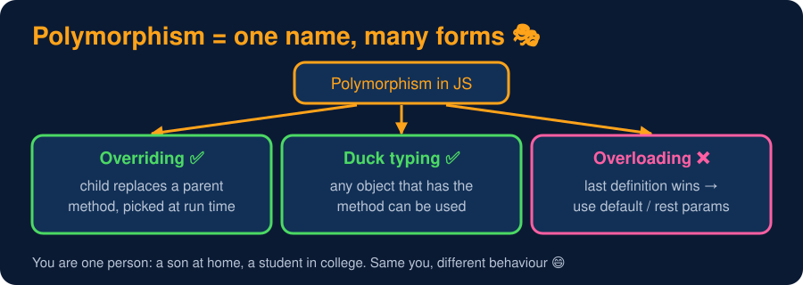

# Polymorphism Overview

<sub>Level 5 : Polymorphism</sub>

> **Easy definition:** **Polymorphism** means **"many forms"**: the **same method call** behaves **differently** depending on the object it's called on.

```js
class Animal { sound() { return "Some sound"; } }
class Dog extends Animal { sound() { return "Bark"; } }
class Cat extends Animal { sound() { return "Meow"; } }

const animals = [new Dog(), new Cat(), new Animal()];
animals.forEach(animal => console.log(animal.sound()));   // ONE line of code, 3 behaviours
```
**Output:**
```
Bark
Meow
Some sound
```
`animal.sound()` is the same call each time, but the result depends on whether `animal` is a `Dog`, a `Cat` or a plain `Animal`. That's polymorphism.



## Kinds of polymorphism in JavaScript

| Kind | In JS? | How |
|---|---|---|
| **Overriding** (runtime polymorphism) | ✅ | child class gives its own version of a parent method ([next page](02-method-overriding.md)) |
| **Duck typing** | ✅ | any object with the right method works, no inheritance needed |
| **Overloading** (same name, different params) | ❌ | last definition wins; simulate with default/rest params ([page 3](03-method-overloading.md)) |
| **Operator overloading** | ❌ | only `valueOf` / `toString` / `Symbol.toPrimitive` tweaks |

> **Runtime** = decided **while** the program runs. JavaScript picks which `sound()` to run at run time, by looking at the actual object (its prototype chain).

## Why it matters

Code that works with the **general type** doesn't need to change when you add new types:

```js
function makeAllSpeak(list) {
  list.forEach(a => console.log(a.sound()));     // no if/else on the type!
}
class Cow { sound() { return "Moo"; } }          // new type, makeAllSpeak() unchanged
makeAllSpeak([new Cow(), { sound: () => "Beep (robot)" }]);
```
**Output:**
```
Moo
Beep (robot)
```
Frontend examples: every React component is "something you can render", every DOM element has `addEventListener`, every promise-like object has `.then()`.

## 🧠 Interview answer

> **"Polymorphism means many forms: the same method or interface behaves differently for different objects. In JavaScript it's mainly achieved through method overriding, where child classes provide their own implementation of a parent method and the right one is picked at run time, and through duck typing, where any object with the required method can be used. JavaScript doesn't support traditional method overloading."**

## 🎯 Memory trick

> **Poly = many, morph = forms 🎭. You're one person: a son at home, a student in college, a customer in a shop.**

---
[← Level 4 : Interview & Revision Questions](../level-4-inheritance/interview-questions.md) · [Level 5](README.md) · [Home](../README.md) · [Method Overriding →](02-method-overriding.md)
