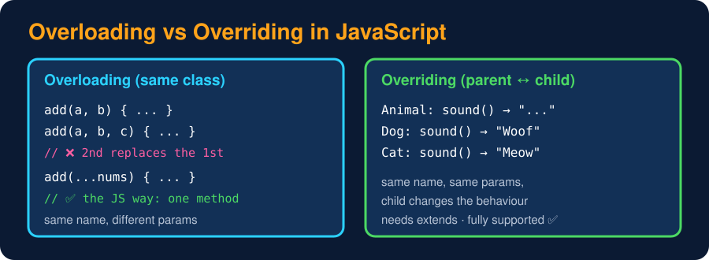

# Method Overloading (and why JS doesn't have it)

<sub>Level 5 : Polymorphism</sub>

> **Easy definition:** **Method overloading** means having several methods with the **same name but different parameters** (different number or types), and the language picks the right one for each call.
> **JavaScript does not support traditional method overloading.**



## What happens if you try?

```js
class Calculator {
  add(a, b) { return a + b; }
  add(a, b, c) { return a + b + c; }      // replaces the first add()!
}

const calc = new Calculator();
console.log(calc.add(2, 3, 4));
console.log(calc.add(2, 3));               // c is undefined → 2 + 3 + undefined
```
**Output:**
```
9
NaN
```
**Why?** Class methods are stored as **properties** on the prototype, and a property name can hold only **one** value. The second `add` simply overwrites the first. (Same for plain functions: the last definition wins.)

## How to get the same effect

**1. Default parameters**
```js
class Calculator {
  add(a, b, c = 0) { return a + b + c; }
}
const calc = new Calculator();
console.log(calc.add(2, 3), calc.add(2, 3, 4));
```
**Output:**
```
5 9
```

**2. Rest parameters** (any number of arguments)
```js
class Calculator {
  add(...nums) {                       // ONE method handles 2, 3, ... arguments
    return nums.reduce((sum, n) => sum + n, 0);
  }
}
const c = new Calculator();
console.log(c.add(2, 3));
console.log(c.add(2.5, 1.5));
console.log(c.add(1, 2, 3));
```
**Output:**
```
5
4
6
```

**3. Check the arguments' types**
```js
function area(shape, a, b) {
  if (shape === "circle") return +(Math.PI * a * a).toFixed(2);
  if (b === undefined) return a * a;           // square
  return a * b;                                // rectangle
}
console.log(area("circle", 1), area("square", 4), area("rect", 2, 5));
```
**Output:**
```
3.14 16 10
```

**4. An options object** for many optional values: `createUser({ name, age, role = "user" })`.

TypeScript lets you write several overload **signatures** for type checking, but there is still only **one** implementation underneath.

## Operator overloading → also not supported

You can't redefine `+` or `===` for your class. You can only control how an object turns into a primitive:

```js
class Money {
  constructor(rs) { this.rs = rs; }
  valueOf()  { return this.rs; }          // used by + - * < > (number context)
  toString() { return `₹${this.rs}`; }    // used by String() and `${}` (string context)
}

const a = new Money(100), b = new Money(50);
console.log(a + b);          // 150 → a plain number, NOT a Money object
console.log(a > b);
console.log(`${a}`);
console.log(a === new Money(100));   // === always compares references
```
**Output:**
```
150
true
₹100
false
```
For real "add two objects", write a method: `a.add(b)`.

## Overriding vs Overloading

| Method Overriding | Method Overloading |
|---|---|
| between **parent and child** classes | usually in the **same** class |
| same name, child gives a **different implementation** | same name, **different parameter lists** |
| needs inheritance | doesn't need inheritance |
| decided at **run time** | decided before running (in languages that have it) |
| ✅ supported in JS | ❌ not supported in JS (simulate it) |

## 🧠 Interview answer

> **"JavaScript supports method overriding through inheritance, but not traditional method overloading. Methods are stored as properties, so if the same method name is defined twice, the last definition replaces the previous one. We get similar behaviour with default parameters, rest parameters, checking argument types, or an options object."**

## 🎯 Memory trick

> **Overriding → child changes parent's method. Overloading → same name, different parameters (JS: the last one wins 🏁).**

---
[← Method Overriding](02-method-overriding.md) · [Level 5](README.md) · [Home](../README.md) · [Level 5 : Interview & Revision Questions →](interview-questions.md)
