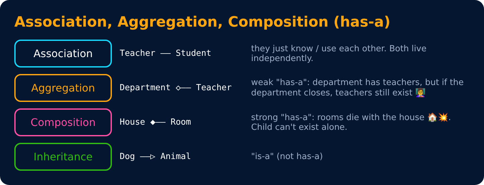
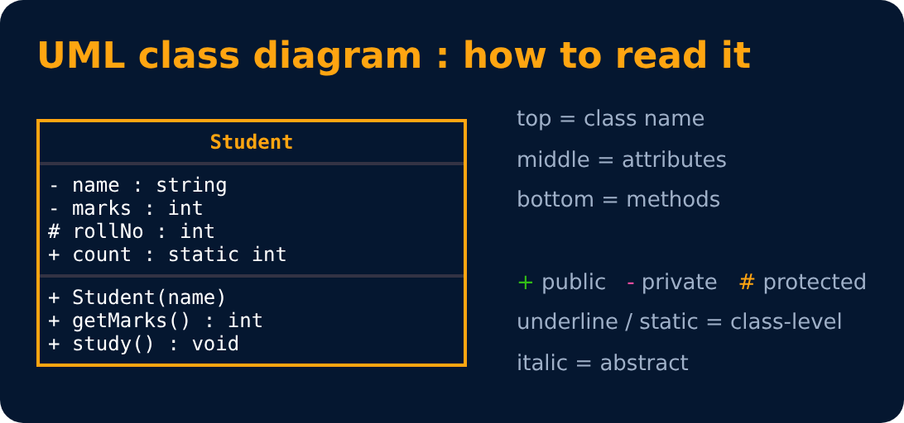

# Composition & Relationships

<sub>Level 6 : Composition, SOLID & Design Patterns</sub>

> **Easy definition:** **Composition** means building an object by **combining other objects** (or behaviours) instead of inheriting from a parent class. It models a **has-a** relationship.

```js
class Engine { start() { console.log("Engine started"); } }
class GPS { route(to) { console.log(`Route to ${to} ready`); } }

class Car {
  constructor() {
    this.engine = new Engine();       // Car HAS an Engine
    this.gps = new GPS();             // Car HAS a GPS
  }
  startTrip(to) {
    this.engine.start();              // delegate work to the parts
    this.gps.route(to);
    console.log("Car started 🚗");
  }
}

new Car().startTrip("Delhi");
```
**Output:**
```
Engine started
Route to Delhi ready
Car started 🚗
```
`Car` does **not** inherit from `Engine`. It **has** an Engine and **uses** it.

## Composition vs Inheritance

```text
Inheritance:  Dog → Animal     "Dog IS an Animal"
Composition:  Car → Engine     "Car HAS an Engine"
```

Inheritance trees get messy as apps grow. Classic problem: `Animal → Bird → Duck` is fine until you need a `RobotDuck` that quacks but doesn't eat or fly. With composition you just **pick the abilities** you need:

```js
// Small "abilities" that work on some shared state
const canWalk = state => ({ walk: () => `${state.name} walks` });
const canFly  = state => ({ fly:  () => `${state.name} flies` });
const canQuack = state => ({ quack: () => `${state.name}: Quack!` });

function createDuck(name) {
  const state = { name };
  return { ...canWalk(state), ...canFly(state), ...canQuack(state) };   // pick what you need
}
function createRobotDuck(name) {
  const state = { name };
  return { ...canWalk(state), ...canQuack(state) };                     // no fly, no problem
}

const d = createDuck("Donald"), r = createRobotDuck("RoboDuck");
console.log(d.fly(), "|", r.quack(), "|", typeof r.fly);
```
**Output:**
```
Donald flies | RoboDuck: Quack! | undefined
```

| Inheritance | Composition |
|---|---|
| "is-a" relationship | "has-a" / "can-do" relationship |
| uses `extends` | combines objects / behaviours |
| decided when you write the class | can be mixed and swapped at run time |
| deep hierarchies get rigid ("you wanted a banana but got the gorilla holding it and the whole jungle" 🦍) | small, independent, reusable pieces |
| tight coupling to the parent | loose coupling |

> 💡 **"Favour composition over inheritance."** Use inheritance only for a true is-a where the child can be used anywhere the parent is.
> React is built on this: a `<Page>` **has** a `<Header>` and `<Sidebar>`, `props.children` plugs components into each other, and custom hooks (`useAuth()`, `useCart()`) are abilities a component composes.

## The 3 has-a relationships



```js
class Teacher { constructor(name) { this.name = name; } }

class Department {
  constructor(teachers) { this.teachers = teachers; }   // AGGREGATION: teachers come from outside,
}                                                       // they still exist if the dept is deleted

class Room { constructor(no) { this.no = no; } }
class House {
  constructor() { this.rooms = [new Room(1), new Room(2)]; }   // COMPOSITION: rooms created inside,
}                                                              // they live and die with the house

class Student {
  ask(teacher, q) { return `${teacher.name}, ${q}`; }   // ASSOCIATION: just uses a Teacher for a moment
}

const ravi = new Teacher("Ravi");
const cse = new Department([ravi]);
console.log(cse.teachers[0].name, new House().rooms.length, new Student().ask(ravi, "doubt?"));
```
**Output:**
```
Ravi 2 Ravi, doubt?
```

| Relationship | Strength | Example | Lifetime |
|---|---|---|---|
| **Association** | "uses" | Student – Teacher | independent |
| **Aggregation** | weak has-a | Department – Teacher | part can exist without the whole |
| **Composition** | strong has-a | House – Room | part dies with the whole |
| **Inheritance** | is-a | Dog – Animal | — |

## Reading a UML class diagram



In JS terms: `+` public, `-` private (`#field`), `#` protected (`_field` by convention), underlined = `static`, italic = "abstract".

## 🧠 Interview answer

> **"Composition is an OOP technique where an object is built by combining other objects or behaviours instead of inheriting from a parent class; it represents a has-a relationship, like a Car that has an Engine. Inheritance represents an is-a relationship. Composition is often preferred because it's more flexible, keeps classes loosely coupled and avoids deep, rigid inheritance hierarchies. Aggregation is a weak has-a where the part can live on its own, while composition is a strong has-a where the part's lifetime depends on the whole."**

## 🎯 Memory trick

> **Inheritance = IS-A 🐶→🐾 · Composition = HAS-A 🚗+⚙️.**

---
[← Level 5 : Interview & Revision Questions](../level-5-polymorphism/interview-questions.md) · [Level 6](README.md) · [Home](../README.md) · [SOLID Principles →](02-solid-principles.md)
