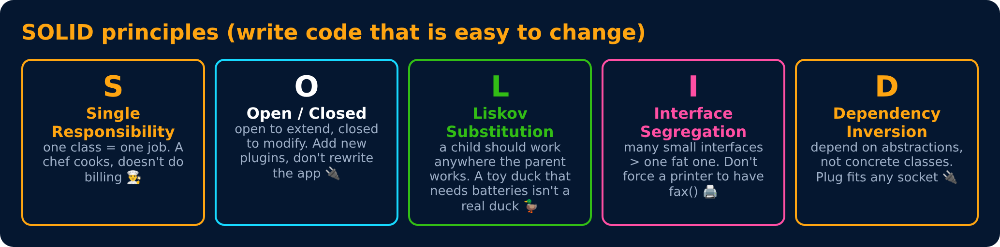

# SOLID Principles

<sub>Level 6 : Composition, SOLID & Design Patterns</sub>

> **Easy definition:** **SOLID** = 5 design rules that make object-oriented code **easy to change, test and extend**.



## S : Single Responsibility (most asked)
> A class (or function/component) should have **one job**, i.e. one reason to change.

```js
// ❌ one class does everything
class Invoice {
  calculateTotal() {}
  printInvoice() {}
  saveToDatabase() {}
}

// ✅ one job per class
class InvoiceCalculator { total(items) { return items.reduce((s, i) => s + i.price, 0); } }
class InvoicePrinter    { print(total) { return `Total: ₹${total}`; } }
class InvoiceRepo       { save(total) { /* fetch("/api/invoices", ...) */ } }
```
In React: a custom hook (`useUser`) loads data, the component only renders.

## O : Open/Closed
> Open for **extension**, closed for **modification**: add new behaviour without editing old, tested code.

```js
// ❌ every new tier = edit this function
function price(type, p) {
  if (type === "gold") return p * 0.9;
  else if (type === "platinum") return p * 0.8;
  return p;
}

// ✅ new tier = add one entry, nothing else changes
const discount = { regular: p => p, gold: p => p * 0.9, platinum: p => p * 0.8 };
const finalPrice = (type, p) => discount[type](p);
console.log(finalPrice("gold", 1000), finalPrice("platinum", 1000));
```
**Output:**
```
900 800
```
Polymorphism does the same with classes: `Shape` + `area()` → adding a `Triangle` class needs no `if (type === "circle")` chain.

## L : Liskov Substitution
> A child class must work **anywhere the parent works**, without surprises.

```js
class Bird { fly() { return "flying"; } }
class Penguin extends Bird {
  fly() { throw new Error("Penguins can't fly!"); }   // ❌ breaks code that expects any Bird to fly
}
```
Fix: don't promise `fly()` in `Bird`. Model it as `Bird` + a separate "can fly" ability (composition), so `Penguin` never claims to fly.

## I : Interface Segregation
> Don't force objects to depend on methods (or data) they **don't use**. Prefer small, focused contracts.

```js
// ❌ a "Machine" contract with print(), scan(), fax() forces a simple printer to fake scan() and fax()
// ✅ small abilities, combine only what's needed
const canPrint = { print(doc) { return `printing ${doc}`; } };
const canScan  = { scan()     { return "scanning"; } };
const simplePrinter = { ...canPrint };
const officeMachine = { ...canPrint, ...canScan };
```
In React: don't pass a whole `user` object to a component that only needs `user.name`.

## D : Dependency Inversion
> Depend on **abstractions** ("something with `send()`"), not on concrete classes. Pass dependencies **in** (dependency injection).

```js
// Notifier depends on "anything with send()", not on a concrete Email class
class Notifier {
  constructor(sender) { this.sender = sender; }   // dependency is INJECTED
  notify(msg) { this.sender.send(msg); }
}

const emailSender = { send: m => console.log("Email:", m) };
const smsSender   = { send: m => console.log("SMS:", m) };

new Notifier(emailSender).notify("Order placed");
new Notifier(smsSender).notify("Order shipped");   // new channel, Notifier unchanged
```
**Output:**
```
Email: Order placed
SMS: Order shipped
```
This also makes testing easy: pass a fake sender in tests. In React, Context is often used to inject such dependencies (an API client, a theme, auth).

## Summary

| Letter | Principle | One line |
|---|---|---|
| S | Single Responsibility | one class, one job |
| O | Open/Closed | extend, don't edit |
| L | Liskov Substitution | child can replace parent safely |
| I | Interface Segregation | small, focused contracts |
| D | Dependency Inversion | depend on abstractions, inject dependencies |

## 🧠 Interview answer

> **"SOLID is five design principles: Single responsibility, one reason to change per class; Open/closed, extend behaviour without modifying existing code; Liskov substitution, a child must be usable wherever its parent is; Interface segregation, don't force code to depend on things it doesn't use; and Dependency inversion, depend on abstractions and inject dependencies instead of hard-coding them. In frontend code, for example, a hook handles data fetching while the component only renders, and an API client is passed in rather than created inside."**

## 🎯 Memory trick

> **S**ingle job · **O**pen to add · **L**ike-for-like swap · **I**nterfaces small · **D**epend on abstractions.

---
[← Composition & Relationships](01-composition-and-relationships.md) · [Level 6](README.md) · [Home](../README.md) · [Design Patterns →](03-design-patterns.md)
