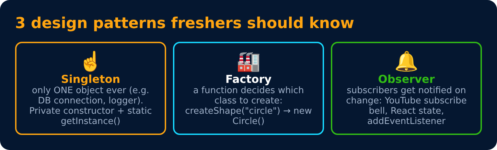

# Design Patterns (basics)

<sub>Level 6 : Composition, SOLID & Design Patterns</sub>

> **Easy definition:** a **design pattern** is a proven, reusable solution to a common design problem. Not code to copy, but a shape to follow.



## Singleton: only ONE object ever
> Ensures a class has **only one instance** and gives one global access point to it (logger, config, store, DB connection).

```js
class Logger {
  static #instance = null;
  static getInstance() {
    if (!Logger.#instance) Logger.#instance = new Logger();
    return Logger.#instance;
  }
  constructor() { console.log("Logger created"); }
  log(msg) { console.log(`[LOG] ${msg}`); }
}

Logger.getInstance().log("app started");
Logger.getInstance().log("user logged in");
console.log(Logger.getInstance() === Logger.getInstance());
```
**Output:**
```
Logger created
[LOG] app started
[LOG] user logged in
true
```
JS has no private constructors, so `new Logger()` is still possible here (you could throw in the constructor if an instance already exists). In real projects the easiest singleton is an **ES module**: `export const logger = new Logger();`. A module runs only once and is cached, so every `import` gets the same object (e.g. a Redux store, an axios instance).

## Factory: let a function decide which class to create
> A function/method creates objects for you, so callers don't need to know the exact class.

```js
class UPI  { pay(amt) { return `Paid ₹${amt} via UPI`; } }
class Card { pay(amt) { return `Paid ₹${amt} via Card`; } }

function createPayment(type) {          // caller never writes `new UPI()` itself
  const types = { upi: UPI, card: Card };
  if (!types[type]) throw new Error("Unknown payment: " + type);
  return new types[type]();
}

console.log(createPayment("upi").pay(500));
console.log(createPayment("card").pay(1200));
```
**Output:**
```
Paid ₹500 via UPI
Paid ₹1200 via Card
```
Real examples: `document.createElement("div")`, `React.createElement()`.

## Observer (pub/sub): notify everyone who subscribed
> An object keeps a list of **subscribers** and **notifies** all of them when something changes.

```js
class EventEmitter {
  #listeners = {};
  on(event, fn) {
    (this.#listeners[event] ??= []).push(fn);
    return () => this.off(event, fn);           // return an "unsubscribe" function
  }
  off(event, fn) {
    this.#listeners[event] = (this.#listeners[event] ?? []).filter(f => f !== fn);
  }
  emit(event, data) {
    (this.#listeners[event] ?? []).forEach(fn => fn(data));
  }
}

const cart = new EventEmitter();
const unsubscribe = cart.on("change", items => console.log("Header badge:", items.length));
cart.on("change", items => console.log("Sidebar:", items.join(", ")));

cart.emit("change", ["shoes", "watch"]);
unsubscribe();
cart.emit("change", ["shoes"]);
```
**Output:**
```
Header badge: 2
Sidebar: shoes, watch
Sidebar: shoes
```
Real examples: `addEventListener`, Node's `EventEmitter`, Redux `store.subscribe`, RxJS, a YouTube subscribe bell 🔔. "Implement an EventEmitter" is a **very common frontend interview question**.

## Other patterns you'll see in JS

| Pattern | JS example |
|---|---|
| **Module** | ES modules / IIFE that hide private variables ([Level 7](../level-7-under-the-hood/05-encapsulation-patterns.md)) |
| **Decorator / HOC** | `withAuth(Component)`, `debounce(fn)`: wrap something to add behaviour |
| **Strategy** | the `discount` lookup object in [SOLID](02-solid-principles.md) |
| **Prototype** | `Object.create(proto)` makes new objects from an existing one |
| **Builder** | chained calls: `query.select("a").where("b").limit(10)` |

## 🧠 Interview answer

> **"Design patterns are reusable solutions to common design problems. Singleton ensures only one instance exists, which in JavaScript is often just an exported module instance. Factory centralizes object creation so callers don't depend on concrete classes. Observer lets subscribers register callbacks and get notified when something changes; `addEventListener` and Redux's `subscribe` are examples."**

## 🎯 Memory trick

> **Singleton = one principal ☝️ · Factory = a shop counter that hands you the right product 🏭 · Observer = YouTube bell 🔔.**

---
[← SOLID Principles](02-solid-principles.md) · [Level 6](README.md) · [Home](../README.md) · [JS OOP Cheat Sheet →](04-js-oop-cheat-sheet.md)
