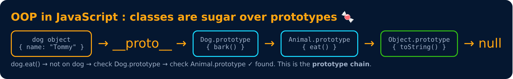

# JS OOP Cheat Sheet

<sub>Level 6 : Composition, SOLID & Design Patterns</sub>

Everything from Levels 1–6 in **one program + one table**, for last-minute revision.

```js
class Animal {
  #secret = "hidden";               // private field (encapsulation)
  static count = 0;                 // static

  constructor(name) {               // constructor
    this.name = name;
    Animal.count++;
  }
  sound() { return "Some sound"; }
  speak() { return `${this.name}: ${this.sound()}`; }
  get secretLength() { return this.#secret.length; }   // getter
}

class Dog extends Animal {          // inheritance
  constructor(name) { super(name); }
  sound() { return "Woof"; }        // overriding (polymorphism)
}

const pets = [new Dog("Tommy"), new Animal("Generic")];
pets.forEach(p => console.log(p.speak()));
console.log(Animal.count, pets[0].secretLength);
```
**Output:**
```
Tommy: Woof
Generic: Some sound
2 6
```

| Concept | JavaScript |
|---|---|
| class / object | `class Car {}` · `new Car()` · object literal `{}` |
| constructor | one per class, named `constructor`; default params for variations |
| class field | `age = 26;` (each object gets its own) |
| `this` | the calling object; decided at **call** time |
| public / private | default / `#name` (no `protected`; `_name` is a convention) |
| getter / setter | `get x() {}` / `set x(v) {}` |
| static | `static count = 0`, `ClassName.method()`; inherited by children |
| inheritance | `class Dog extends Animal` (one parent only) |
| call parent | `super(args)` in constructor, `super.method()` elsewhere |
| overriding | redefine the method in the child; always chosen at run time |
| overloading | ❌ last definition wins → default / rest params |
| abstract class | throw when `new.target === Base`; TS `abstract` |
| interface | duck typing; TS `interface` |
| multiple inheritance | ❌ → mixins / composition |
| copy | `{...obj}` shallow · `structuredClone(obj)` deep |
| destroy | ❌ no destructor; GC + manual cleanup (`using` + `Symbol.dispose`) |
| immutability | `Object.freeze` (shallow); `const` only locks the variable |
| under the hood | prototype chain; `class` is sugar ([Level 7](../level-7-under-the-hood/README.md)) |



> React tip: class components (`class App extends React.Component`) use these ideas, but modern React mostly uses **functions + hooks** (composition over inheritance!).

👉 Next: [Level 7 : Under the Hood](../level-7-under-the-hood/README.md)

---
[← Design Patterns](03-design-patterns.md) · [Level 6](README.md) · [Home](../README.md) · [Level 6 : Interview & Revision Questions →](interview-questions.md)
