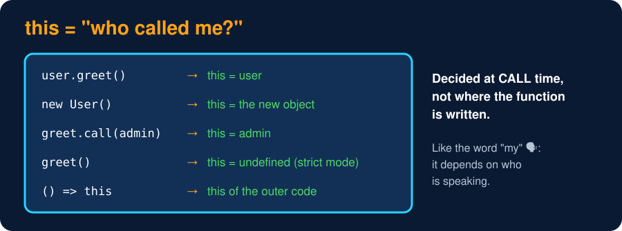

# The `this` Keyword

<sub>Level 7 : Under the Hood</sub>

> **Easy definition:** `this` refers to the object a function is working with. In JavaScript it is **decided when the function is called**, by *how* it is called, not where it is written.



## The 4 binding rules (+ arrow functions)

| # | How the function is called | `this` is | Example |
|---|---|---|---|
| 1 | **Default**: plain call | `undefined` in strict mode (classes, modules), `globalThis`/`window` otherwise | `f()` |
| 2 | **Implicit**: called on an object | the object before the dot | `user.greet()` |
| 3 | **Explicit**: `call` / `apply` / `bind` | the object you pass | `f.call(obj)` |
| 4 | **new**: called with `new` | the brand-new object | `new Person()` |
| ➕ | **Arrow function** | no own `this`: uses `this` of the surrounding code (lexical) | `() => this.x` |

**Priority:** `new` > `bind` (explicit) > implicit (`obj.f()`) > default. Arrow functions ignore all of these.

```js
"use strict";
function whoAmI() { return this; }

const user = {
  name: "Gagan",
  greet() { return `Hi ${this.name}`; },
};

console.log(whoAmI());                 // 1. default binding → undefined (strict mode)
console.log(user.greet());             // 2. implicit binding → object before the dot
const greet = user.greet;
try { greet(); } catch (e) { console.log("lost this →", e.message); }

function intro(city, role) { return `${this.name} from ${city}, ${role}`; }
const ravi = { name: "Ravi" };
console.log(intro.call(ravi, "Delhi", "SDE"));      // 3. explicit: call (args one by one)
console.log(intro.apply(ravi, ["Pune", "QA"]));     //             apply (args as array)
const raviIntro = intro.bind(ravi, "Noida");        //             bind (returns new fn)
console.log(raviIntro("PM"));

function Person(name) { this.name = name; }
console.log(new Person("Asha").name);               // 4. new binding → brand-new object
```
**Output:**
```
undefined
Hi Gagan
lost this → Cannot read properties of undefined (reading 'name')
Ravi from Delhi, SDE
Ravi from Pune, QA
Ravi from Noida, PM
Asha
```

## call vs apply vs bind

| | Runs the function now? | Arguments | Returns |
|---|---|---|---|
| `call(obj, a, b)` | ✅ | one by one | the result |
| `apply(obj, [a, b])` | ✅ | as an array | the result |
| `bind(obj, a)` | ❌ | can pre-fill some (partial application) | a **new function** with `this` locked forever |

Memory trick: **C**all = **C**ommas, **A**pply = **A**rray, **B**ind = **B**ack later.

## Arrow functions & callbacks

A normal `function` inside a method gets its own `this` (lost). An arrow function borrows `this` from the method around it:

```js
"use strict";
const team = {
  name: "Frontend",
  members: ["Gagan", "Ravi"],
  listNormal() {
    return this.members.map(function (m) { return `${m} (${this?.name})`; });
  },
  listArrow() {
    return this.members.map(m => `${m} (${this.name})`);   // arrow borrows `this` from listArrow
  },
};
console.log(team.listNormal());
console.log(team.listArrow());
```
**Output:**
```
[ 'Gagan (undefined)', 'Ravi (undefined)' ]
[ 'Gagan (Frontend)', 'Ravi (Frontend)' ]
```
⚠️ Don't use an arrow function **as an object method** (`greet: () => this.name`): it takes `this` from outside the object, not the object.

## Losing `this` in classes (React onClick / setTimeout bug)

```js
class Counter {
  count = 0;
  incNormal() { this.count++; }           // on the prototype, `this` decided at call time
  incArrow = () => { this.count++; };     // class field arrow: `this` locked to the instance
}

const c = new Counter();
const { incNormal, incArrow } = c;        // like passing c.incNormal to onClick / setTimeout
try { incNormal(); } catch (e) { console.log("incNormal:", e.message); }
incArrow();
incArrow();
console.log("count:", c.count);
console.log("on prototype?", "incNormal" in Counter.prototype, "incArrow" in Counter.prototype);
```
**Output:**
```
incNormal: Cannot read properties of undefined (reading 'count')
count: 2
on prototype? true false
```
**3 fixes:** `this.inc = this.inc.bind(this)` in the constructor · arrow class field (above) · wrap at the call site: `onClick={() => this.inc()}`.

Trade-off of arrow fields: each object gets its **own copy** of the function (more memory), and it isn't on the prototype, so a child class can't call it with `super.inc()`.

## 🧠 Interview answer

> **"In JavaScript, `this` is determined by how a function is called. With `new` it's the new object; with `call`, `apply` or `bind` it's the object we pass; when called as `obj.method()` it's `obj`; and in a plain call it's `undefined` in strict mode or the global object otherwise. Arrow functions don't have their own `this`; they use the `this` of the surrounding scope."**

## 🎯 Memory trick

> **Ask "who is to the LEFT of the dot at call time?" No dot → no object (undefined). Arrow → look outside.**

---
[← Level 6 : Interview & Revision Questions](../level-6-advanced/interview-questions.md) · [Level 7](README.md) · [Home](../README.md) · [Constructor Functions & the new Keyword →](02-constructor-functions-and-new.md)
