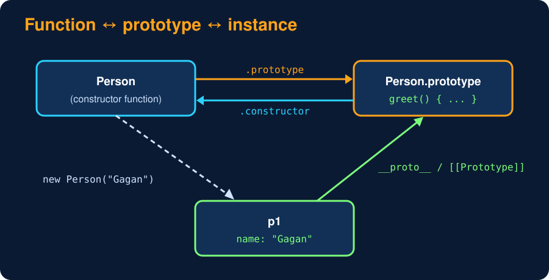

# Constructor Functions & the `new` Keyword

<sub>Level 7 : Under the Hood</sub>

Before ES6 (2015) JavaScript had no `class`. A **constructor function** (a normal function, named with a Capital letter by convention) + `new` did the job. Classes still work this way underneath.

```js
function Person(name) {                // constructor function (the pre-ES6 "class")
  this.name = name;
}
Person.prototype.hi = function () {    // shared method: stored ONCE on the prototype
  return `Hi, I'm ${this.name}`;
};

const p1 = new Person("Gagan");
const p2 = new Person("Ravi");
console.log(p1.hi(), "|", p2.hi());
console.log(p1.hi === p2.hi);          // same function object

// ❌ methods created inside the constructor are copied into EVERY object
function Bad(name) { this.name = name; this.hi = function () {}; }
console.log(new Bad("a").hi === new Bad("b").hi);
```
**Output:**
```
Hi, I'm Gagan | Hi, I'm Ravi
true
false
```
> 💡 Put **data** in the constructor (`this.x = ...`) and **methods** on the prototype. 1000 objects → 1000 names, but still only one `hi` function.



## What does `new` do? (very common question)

`new Person("Gagan")` does 4 steps:

1. Creates a new empty object `{}`.
2. Links its prototype: `obj.__proto__ = Person.prototype`.
3. Calls `Person` with `this = obj` and the given arguments.
4. Returns `obj`, unless the function itself returned another **object**.

**Write your own `new`:**
```js
function Person(name) { this.name = name; }
Person.prototype.hi = function () { return `Hi, I'm ${this.name}`; };

function myNew(Ctor, ...args) {
  const obj = Object.create(Ctor.prototype);          // steps 1 + 2
  const result = Ctor.apply(obj, args);               // step 3
  const isObject = result !== null && (typeof result === "object" || typeof result === "function");
  return isObject ? result : obj;                     // step 4
}

const p = myNew(Person, "Asha");
console.log(p.hi(), p instanceof Person);
```
**Output:**
```
Hi, I'm Asha true
```

## Forgetting `new`

```js
function Car() { this.speed = 0; }
const c = Car();         // no `new`!
// c is undefined, and in sloppy mode `speed` leaks onto the global object
```
In strict mode it throws instead (`this` is `undefined`). ES6 classes **always** throw if called without `new`, one reason classes are safer.

## 3 ways to make many similar objects

| | Constructor function | ES6 class | Factory function |
|---|---|---|---|
| code | `function User(n) { this.n = n }` | `class User { constructor(n) {...} }` | `const createUser = n => ({ n, hi() {} })` |
| needs `new` | yes (silent bug if forgotten) | yes (error if forgotten) | no |
| shared methods via prototype | yes | yes | no (each object gets its own, unless you use `Object.create`) |
| private data | closures | `#private` | closures |
| `instanceof` works | yes | yes | no |
| `this` problems | yes | yes | can avoid `this` entirely |

React function components and hooks lean on the **factory + closure** style.

## 🧠 Interview answer

> **"A constructor function is a regular function, named with a capital letter, that is called with `new` to create objects. `new` creates an empty object, links it to the function's `prototype`, runs the function with `this` bound to the new object, and returns it. Methods should be put on the prototype so all instances share one copy, while instance data is set in the constructor via `this`."**

## 🎯 Memory trick

> **new = Create → Link → Call → Return. Data in the constructor, methods on the prototype.**

---
[← The this Keyword](01-this-keyword.md) · [Level 7](README.md) · [Home](../README.md) · [Prototypes & the Prototype Chain →](03-prototypes.md)
