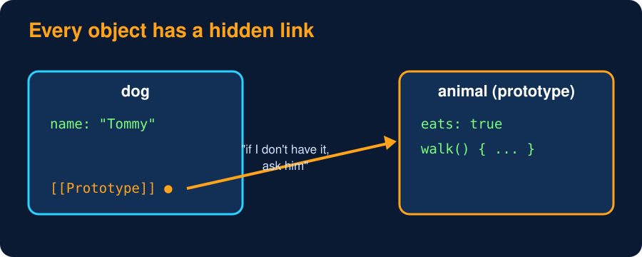
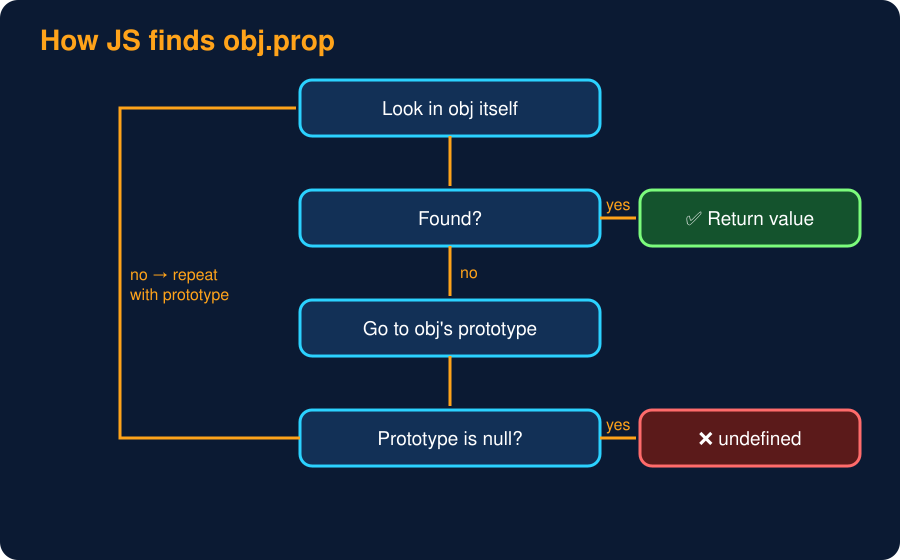
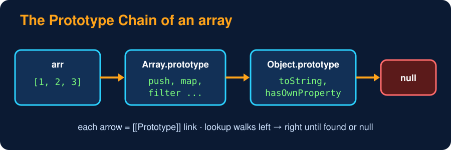

# Prototypes & the Prototype Chain

<sub>Level 7 : Under the Hood</sub>



Every JS object has a hidden link to another object, called its **prototype** (`[[Prototype]]`). When you read a property that the object doesn't have, JS looks in its prototype, then the prototype's prototype, and so on until `null`. That path is the **prototype chain**, and it is how inheritance works in JS.

```js
const animal = {
  eats: true,
  walk() { return `${this.name} walks`; },
};

const dog = Object.create(animal);     // dog's prototype = animal
dog.name = "Tommy";
dog.barks = true;

console.log(dog.walk());                               // not on dog → found on animal
console.log(dog.eats, dog.barks);
console.log(Object.hasOwn(dog, "eats"), Object.hasOwn(dog, "barks"));
console.log(Object.getPrototypeOf(dog) === animal);
console.log(Object.getPrototypeOf(animal) === Object.prototype);
console.log(Object.getPrototypeOf(Object.prototype));  // end of the chain

dog.eats = false;                      // creates dog's OWN property (shadowing)
console.log(dog.eats, animal.eats);    // animal is untouched
```
**Output:**
```
Tommy walks
true true
false true
true
true
null
false true
```
Chain here: `dog → animal → Object.prototype → null`.



- **Reading** a property walks up the chain.
- **Writing** a property always creates/updates it on the object itself (it **shadows** the prototype's one, never changes the prototype).
- Inside an inherited method, `this` is still the object you called it on (`dog`), not the prototype.

## `__proto__` vs `prototype` (most confusing, most asked)

| | `obj.__proto__` | `Func.prototype` |
|---|---|---|
| exists on | every object | functions / classes only |
| meaning | "the object I inherit from" | "the object that **instances** made with `new Func()` will inherit from" |
| modern way | `Object.getPrototypeOf(obj)` / `Object.setPrototypeOf` | same |

```js
class Dog {}
const d = new Dog();
Object.getPrototypeOf(d) === Dog.prototype;   // true
Dog.prototype.constructor === Dog;            // true
```


Built-in chains: `[1,2] → Array.prototype → Object.prototype → null` (that's where `map`, `filter` come from). `function f(){} → Function.prototype → Object.prototype → null`.

## Inheritance without `class` (ES5 way, asked to check your basics)

```js
function Animal(name) { this.name = name; }
Animal.prototype.eat = function () { return `${this.name} eats`; };

function Dog(name) {
  Animal.call(this, name);                          // = super(name)
}
Dog.prototype = Object.create(Animal.prototype);    // = extends Animal
Dog.prototype.constructor = Dog;                    // repair the constructor link
Dog.prototype.bark = function () { return "Woof"; };

const d = new Dog("Tommy");
console.log(d.eat(), "|", d.bark());
console.log(d instanceof Dog, d instanceof Animal, d.constructor.name);
```
**Output:**
```
Tommy eats | Woof
true true Dog
```
`class Dog extends Animal { constructor(n) { super(n); } }` does exactly this for you.

## How `instanceof` really works

`obj instanceof Ctor` walks `obj`'s prototype chain and checks whether `Ctor.prototype` appears anywhere in it.

```js
function myInstanceOf(obj, Ctor) {
  let proto = Object.getPrototypeOf(obj);
  while (proto !== null) {
    if (proto === Ctor.prototype) return true;   // found it on the chain
    proto = Object.getPrototypeOf(proto);        // go one level up
  }
  return false;
}

class Animal {}
class Dog extends Animal {}
const d = new Dog();
console.log(myInstanceOf(d, Dog), myInstanceOf(d, Animal), myInstanceOf(d, Object), myInstanceOf(d, Array));
console.log(myInstanceOf([], Array), myInstanceOf([], Object));
```
**Output:**
```
true true true false
true true
```

## Useful prototype tools

| Tool | Does |
|---|---|
| `Object.create(proto)` | new object with the given prototype (`Object.create(null)` = no prototype at all, a clean dictionary) |
| `Object.getPrototypeOf(o)` / `Object.setPrototypeOf(o, p)` | read / change the prototype (changing is slow, avoid) |
| `Object.hasOwn(o, "k")` / `o.hasOwnProperty("k")` | own property only, ignores the chain |
| `"k" in o` | own **or** inherited |
| `Object.keys(o)` | own enumerable keys only |
| `for...in` | own **and** inherited enumerable keys |
| `Proto.isPrototypeOf(o)` | is `Proto` anywhere in `o`'s chain? |

> ⚠️ Don't add methods to built-in prototypes (`Array.prototype.myThing = ...`) in app code ("monkey patching"): it can clash with future JS features. It's OK for **polyfills**, which add a missing standard method only `if (!Array.prototype.at)`.

## 🧠 Interview answer

> **"A prototype is an object from which other objects inherit properties and methods. Every object has a hidden `[[Prototype]]` link; when a property isn't found on the object, JavaScript looks it up on the prototype, then that prototype's prototype, and so on until `null`. That's the prototype chain, and it's how inheritance works in JavaScript. `prototype` is a property of constructor functions and classes that becomes the `[[Prototype]]` of instances made with `new`, while `__proto__` (or `Object.getPrototypeOf`) gives the prototype an object actually inherits from: `instance.__proto__ === Constructor.prototype`."**

## 🎯 Memory trick

> **Prototype = a "backup object": if I don't have it, my prototype might 👨‍👦. `prototype` = what I GIVE my children 🎁, `__proto__` = who I GOT it from.**

---
[← Constructor Functions & the new Keyword](02-constructor-functions-and-new.md) · [Level 7](README.md) · [Home](../README.md) · [ES6 Classes Under the Hood →](04-classes-under-the-hood.md)
