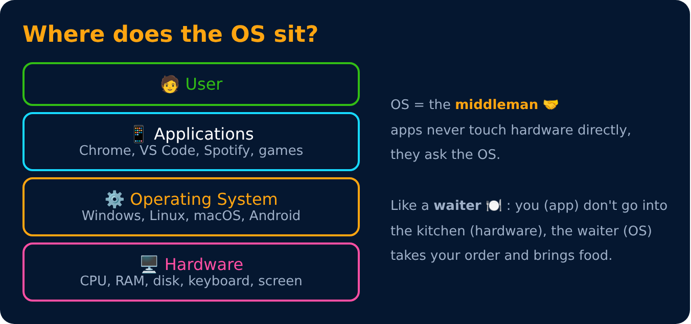
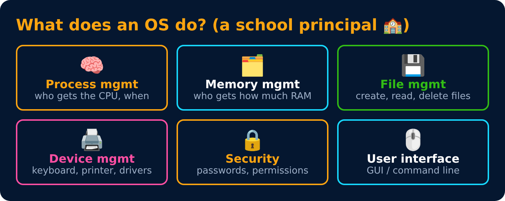

# What is an Operating System?

Level 1 : OS Basics

An **Operating System (OS)** is software that **manages the computer's hardware** and gives programs a simple way to use it.

Without an OS, every app would have to know how to talk to your exact keyboard, disk and screen. 😵 The OS does that work once, for everyone.

**Examples:** Windows, Linux (Ubuntu), macOS, Android, iOS

## Two main goals

| Goal | Meaning |
|---|---|
| **Convenience** | easy for users & programs to use the computer |
| **Efficiency** | use CPU, memory and disk well, no waste |

## Functions of an OS

> 💡 Interview line: *"An OS is a resource manager. It manages CPU, memory, files and devices, and acts as an interface between the user and the hardware."*

---
[Level 1](README.md) · [Home](../README.md) · [Types of Operating Systems →](02-types-of-os.md)
