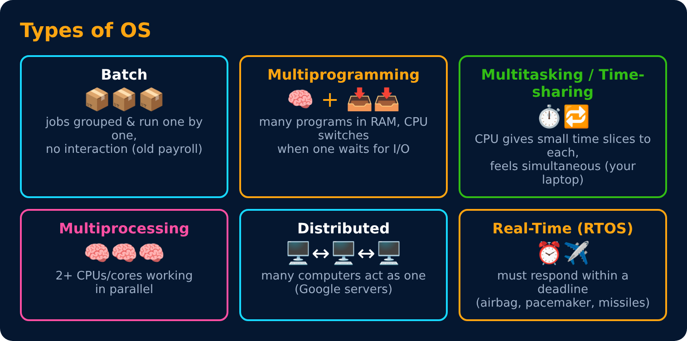

# Types of Operating Systems

Level 1 : OS Basics

## Multiprogramming vs Multitasking (often confused!)

| | Multiprogramming | Multitasking (time-sharing) |
|---|---|---|
| Idea | keep CPU busy | give every user/app a quick turn |
| Switches when | a process waits for I/O | its time slice ends (or I/O) |
| Goal | max CPU use | fast response for the user |
| Example | old mainframes | your laptop running music + Chrome |

## Multiprocessing vs Multithreading

- **Multiprocessing** = many **CPUs** working together (hardware).
- **Multithreading** = one process split into many **threads** (software). More in Level 2.

## RTOS : two kinds

- **Hard real-time** : missing a deadline = disaster (airbag 🚗, pacemaker ❤️).
- **Soft real-time** : missing a deadline = poor quality, not disaster (video call lag 📹).

---
[← What is an Operating System?](01-what-is-an-os.md) · [Level 1](README.md) · [Home](../README.md) · [Kernel & Shell →](03-kernel-and-shell.md)
