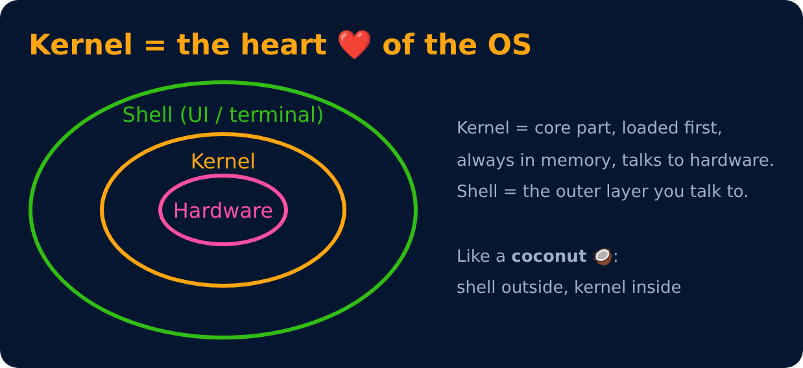
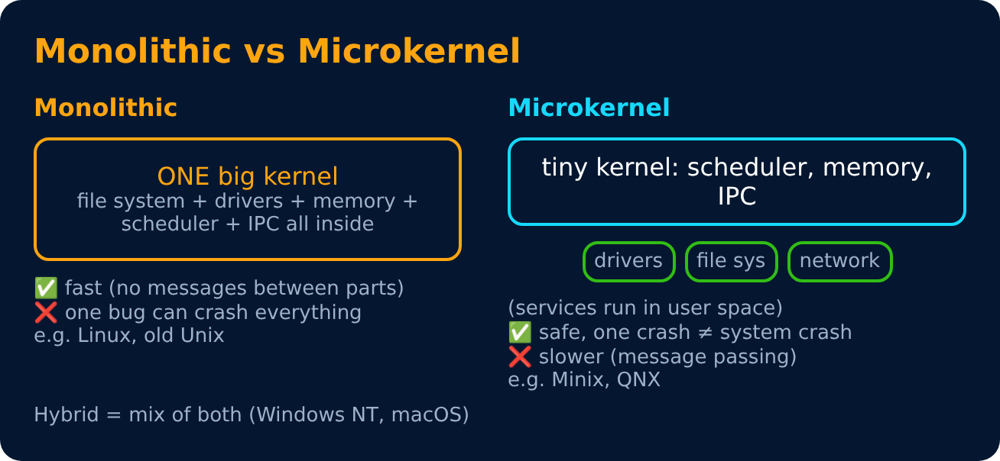

# Kernel & Shell

Level 1 : OS Basics

**Kernel** : the core of the OS. First thing loaded at boot, always stays in RAM, directly controls hardware.

**Shell** : the program that takes your commands and passes them to the kernel. It can be a **CLI** (bash, PowerShell) or a **GUI** (Windows desktop).

## Types of kernel

| Type | Example |
|---|---|
| Monolithic | Linux, MS-DOS |
| Microkernel | Minix, QNX, L4 |
| Hybrid | Windows NT, macOS (XNU) |

---
[← Types of Operating Systems](02-types-of-os.md) · [Level 1](README.md) · [Home](../README.md) · [User Mode, Kernel Mode & System Calls →](04-user-mode-kernel-mode-system-calls.md)
