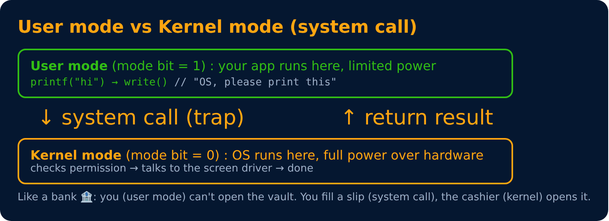

# User Mode, Kernel Mode & System Calls

Level 1 : OS Basics

The CPU has (at least) two modes, so a buggy app can't crash the whole machine.

## System call

A **system call** is how a program asks the kernel to do something it isn't allowed to do itself.

| Type | Examples (Linux) |
|---|---|
| Process control | `fork()`, `exec()`, `exit()`, `wait()` |
| File management | `open()`, `read()`, `write()`, `close()` |
| Device management | `ioctl()`, `read()`, `write()` |
| Information | `getpid()`, `time()` |
| Communication | `pipe()`, `socket()`, `shmget()` |

## Interrupt vs system call

- **Interrupt** : a signal from **hardware** (key pressed ⌨️, disk finished) or a timer → CPU pauses and handles it.
- **System call / trap** : a **software** request from a program to the kernel.
- Both switch the CPU from user mode to kernel mode.

---
[← Kernel & Shell](03-kernel-and-shell.md) · [Level 1](README.md) · [Home](../README.md) · [Booting Process →](05-booting.md)
