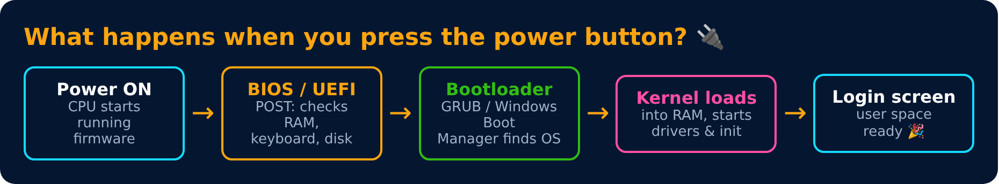

# Booting Process

Level 1 : OS Basics

- **BIOS / UEFI** : firmware stored on the motherboard. UEFI is the modern replacement for BIOS (faster, supports big disks, secure boot).
- **POST** (Power-On Self Test) : quick hardware check. That "beep" at startup is POST.
- **Bootloader** : small program that loads the kernel (GRUB on Linux, Windows Boot Manager).
- **init / systemd** : the first user-space process (PID 1). It starts all other services.

> 💡 Cold boot = starting from power off. Warm boot = restart without cutting power.

---
[← User Mode, Kernel Mode & System Calls](04-user-mode-kernel-mode-system-calls.md) · [Level 1](README.md) · [Home](../README.md) · [Level 1 : Interview & Revision Questions →](interview-questions.md)
