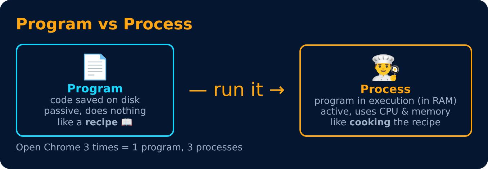
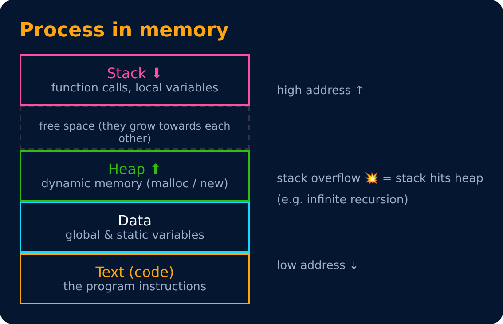
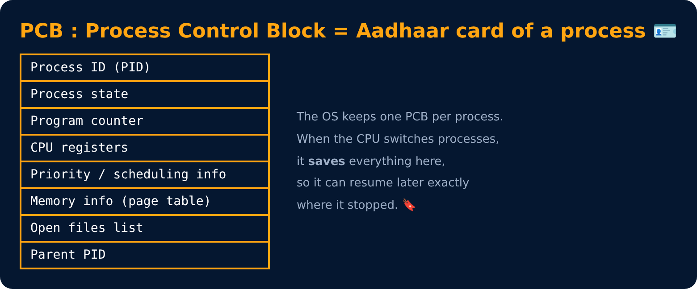

# Process, Process Memory & PCB

Level 2 : Processes & Threads

## What a process looks like in memory

## PCB (Process Control Block)

---
[← Level 1 : Interview & Revision Questions](../level-1-basics/interview-questions.md) · [Level 2](README.md) · [Home](../README.md) · [Process States & Context Switch →](02-process-states-and-context-switch.md)
