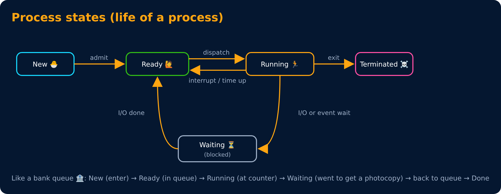
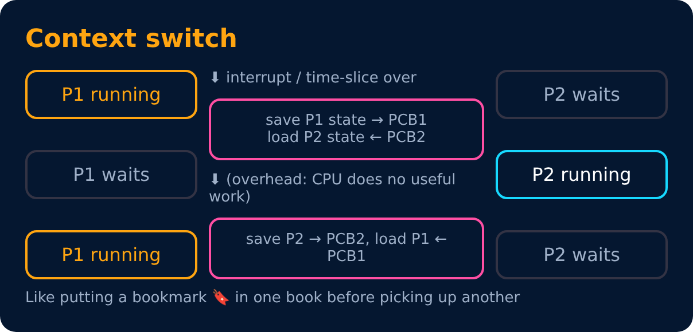

# Process States & Context Switch

Level 2 : Processes & Threads

| State | Meaning |
|---|---|
| **New** | being created |
| **Ready** | in RAM, waiting for CPU |
| **Running** | instructions are executing on CPU |
| **Waiting / Blocked** | waiting for I/O or an event (e.g. file read, key press) |
| **Terminated** | finished |

> Some books add **Suspended Ready / Suspended Wait** : the process is swapped out to disk to free RAM.

## Schedulers

| Scheduler | Job | Speed |
|---|---|---|
| **Long-term** (job scheduler) | which jobs enter RAM (New → Ready) | slow, rare |
| **Short-term** (CPU scheduler) | which ready process gets the CPU next | very fast, very often |
| **Medium-term** | swaps processes out/in (suspend) | in between |

The **dispatcher** actually hands the CPU to the chosen process. Time it takes = **dispatch latency**.

## Context switch

Context switch time is **pure overhead**. Too many switches = CPU busy switching, not working.

---
[← Process, Process Memory & PCB](01-process.md) · [Level 2](README.md) · [Home](../README.md) · [Threads & Multithreading →](03-threads.md)
