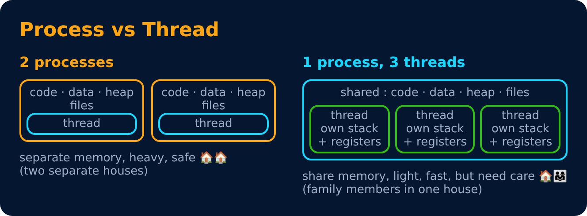
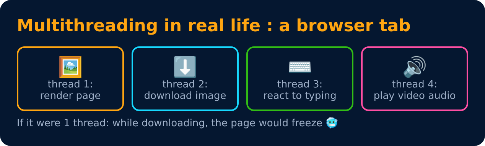

# Threads & Multithreading

Level 2 : Processes & Threads

A **thread** is the smallest unit of execution inside a process. A process can have many threads that run "together".

| | Process | Thread |
|---|---|---|
| Memory | own, separate | shares the process memory |
| Creation | slow, heavy | fast, light |
| Communication | needs IPC | easy (shared variables) |
| Crash | doesn't affect others | can crash the whole process |
| Context switch | slower | faster |

## User-level vs kernel-level threads

- **User-level** : managed by a library, the kernel doesn't know about them. Fast, but if one blocks, all block.
- **Kernel-level** : managed by the OS. Slower to create, but one blocking doesn't stop the others.
- Models : many-to-one, one-to-one (Linux, Windows), many-to-many.

> 💡 JavaScript in the browser is single-threaded, but Web Workers give you extra threads.

---
[← Process States & Context Switch](02-process-states-and-context-switch.md) · [Level 2](README.md) · [Home](../README.md) · [fork(), Zombie & Orphan Processes →](04-fork-zombie-orphan.md)
