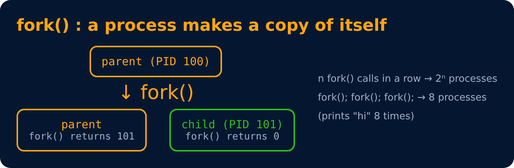
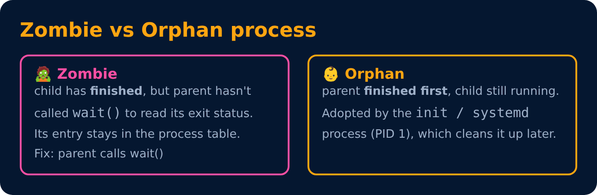

# fork(), Zombie & Orphan Processes

<sub>Level 2 : Processes & Threads</sub>



```c
#include <stdio.h>
#include <unistd.h>
int main() {
    pid_t pid = fork();
    if (pid == 0)  printf("I am the child\n");
    else           printf("I am the parent, child pid = %d\n", pid);
}
```

- `fork()` returns **0** in the child, the **child's PID** in the parent, **−1** on error.
- `exec()` replaces the current process's program with a new one (fork + exec = how a shell runs commands).
- `wait()` makes the parent wait for the child to finish.



---
[← Threads & Multithreading](03-threads.md) · [Level 2](README.md) · [Home](../README.md) · [Inter-Process Communication (IPC) →](05-ipc.md)
