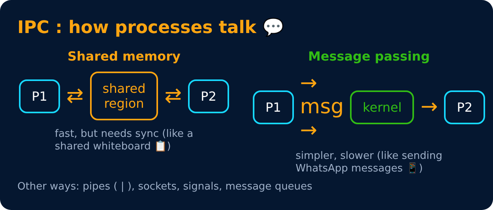

# Inter-Process Communication (IPC)

Level 2 : Processes & Threads

Processes have separate memory, so they need special ways to share data.

| Method | Quick idea |
|---|---|
| **Pipe** | one-way channel, parent ↔ child (`ls | grep txt`) |
| **Named pipe (FIFO)** | pipe with a name, unrelated processes can use it |
| **Message queue** | kernel-managed mailbox of messages |
| **Shared memory** | fastest, same memory region mapped into both |
| **Socket** | communication over a network (or locally) |
| **Signal** | small notification, e.g. `Ctrl+C` sends SIGINT |

---
[← fork(), Zombie & Orphan Processes](04-fork-zombie-orphan.md) · [Level 2](README.md) · [Home](../README.md) · [Level 2 : Interview & Revision Questions →](interview-questions.md)
