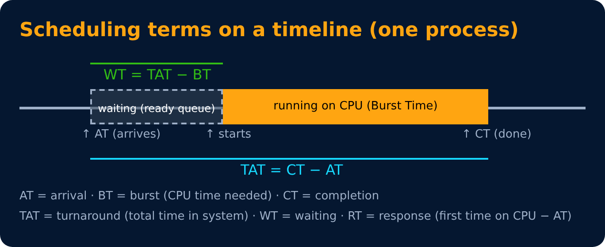
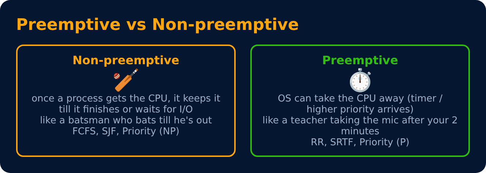

# CPU Scheduling Basics

Level 3 : CPU Scheduling

**CPU scheduling** = deciding which process in the ready queue gets the CPU next. Like a doctor 👩‍⚕️ deciding which patient to call in.

## Important terms

| Term | Formula / meaning |
|---|---|
| Arrival Time (AT) | when it enters the ready queue |
| Burst Time (BT) | CPU time it needs |
| Completion Time (CT) | when it finishes |
| Turnaround Time (TAT) | **CT − AT** |
| Waiting Time (WT) | **TAT − BT** |
| Response Time (RT) | first time it gets the CPU − AT |
| Throughput | processes finished per unit time |

## Goals of a good scheduler
**Maximize** CPU utilization & throughput · **Minimize** turnaround, waiting & response time · be **fair** (no starvation)

## Preemptive vs Non-preemptive

## Example used in all the next files

| Process | Arrival Time (AT) | Burst Time (BT) | Priority |
|---|---|---|---|
| P1 | 0 | 5 | 3 |
| P2 | 1 | 3 | 1 |
| P3 | 2 | 1 | 4 |
| P4 | 3 | 2 | 2 |

(Priority: lower number = higher priority)

---
[← Level 2 : Interview & Revision Questions](../level-2-processes-threads/interview-questions.md) · [Level 3](README.md) · [Home](../README.md) · [FCFS, SJF & SRTF →](02-fcfs-sjf-srtf.md)
