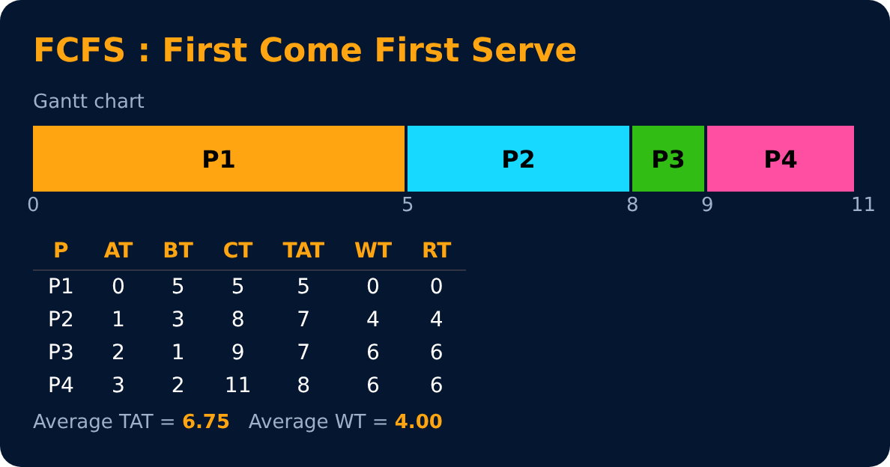
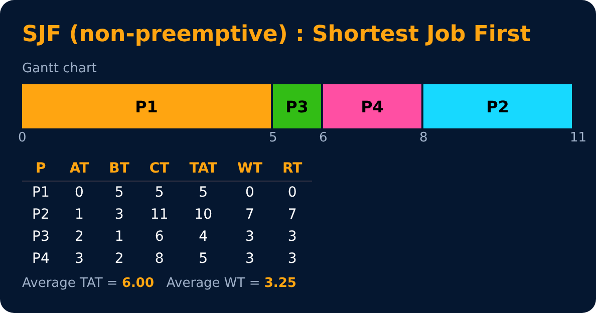
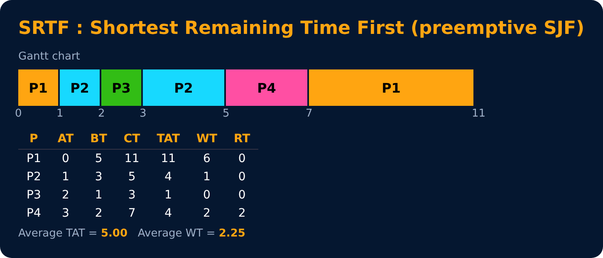

# FCFS, SJF & SRTF

Level 3 : CPU Scheduling

## 1. FCFS : First Come First Serve (non-preemptive)
Whoever arrives first runs first. Like a ticket counter queue 🎟️.

| Process | AT | BT | CT | TAT = CT − AT | WT = TAT − BT | RT |
|---|---|---|---|---|---|---|
| P1 | 0 | 5 | 5 | 5 | 0 | 0 |
| P2 | 1 | 3 | 8 | 7 | 4 | 4 |
| P3 | 2 | 1 | 9 | 7 | 6 | 6 |
| P4 | 3 | 2 | 11 | 8 | 6 | 6 |

**Average TAT = 6.75, Average WT = 4.00**

✅ simple, fair in order · ❌ **convoy effect**, high average waiting time

## 2. SJF : Shortest Job First (non-preemptive)
From the processes that have arrived, pick the one with the **smallest burst time**.

| Process | AT | BT | CT | TAT = CT − AT | WT = TAT − BT | RT |
|---|---|---|---|---|---|---|
| P1 | 0 | 5 | 5 | 5 | 0 | 0 |
| P2 | 1 | 3 | 11 | 10 | 7 | 7 |
| P3 | 2 | 1 | 6 | 4 | 3 | 3 |
| P4 | 3 | 2 | 8 | 5 | 3 | 3 |

**Average TAT = 6.00, Average WT = 3.25**

At time 0 only P1 is there, so it runs till 5. Then P3 (1) < P4 (2) < P2 (3).

✅ minimum average waiting time (optimal, non-preemptive) · ❌ we can't know burst time in advance (it's predicted), long jobs may **starve**

## 3. SRTF : Shortest Remaining Time First (preemptive SJF)
Every time a new process arrives, compare **remaining** times. The shortest one takes the CPU.

| Process | AT | BT | CT | TAT = CT − AT | WT = TAT − BT | RT |
|---|---|---|---|---|---|---|
| P1 | 0 | 5 | 11 | 11 | 6 | 0 |
| P2 | 1 | 3 | 5 | 4 | 1 | 0 |
| P3 | 2 | 1 | 3 | 1 | 0 | 0 |
| P4 | 3 | 2 | 7 | 4 | 2 | 2 |

**Average TAT = 5.00, Average WT = 2.25**

At t=1, P2 arrives with 3 < P1's remaining 4 → P1 is preempted. At t=2, P3 (1) beats P2's remaining 2.

✅ lowest average waiting time of all · ❌ starvation, lots of context switches

---
[← CPU Scheduling Basics](01-scheduling-basics.md) · [Level 3](README.md) · [Home](../README.md) · [Priority, Round Robin & Multilevel Queues →](03-priority-rr-multilevel.md)
