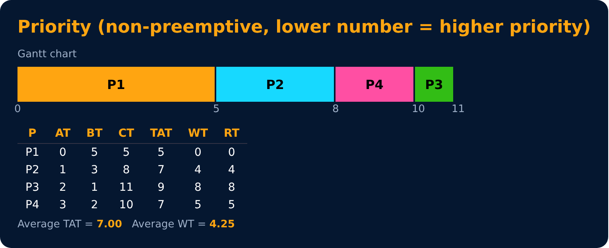
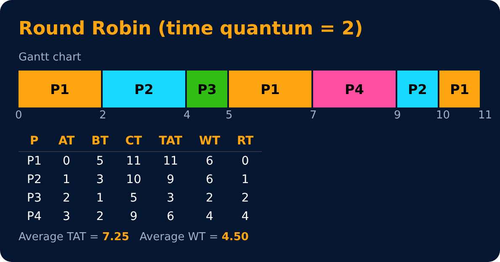
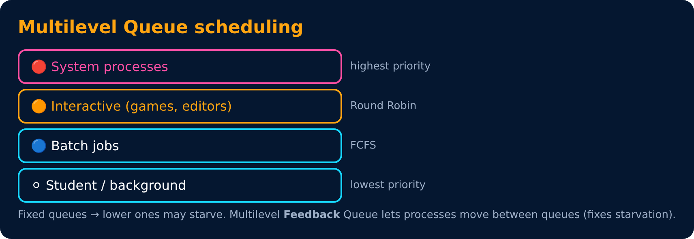

# Priority, Round Robin & Multilevel Queues

Level 3 : CPU Scheduling

## 4. Priority scheduling
Each process has a priority; highest priority runs first (here: lower number = higher). Can be preemptive or non-preemptive.

| Process | AT | BT | CT | TAT = CT − AT | WT = TAT − BT | RT |
|---|---|---|---|---|---|---|
| P1 | 0 | 5 | 5 | 5 | 0 | 0 |
| P2 | 1 | 3 | 8 | 7 | 4 | 4 |
| P3 | 2 | 1 | 11 | 9 | 8 | 8 |
| P4 | 3 | 2 | 10 | 7 | 5 | 5 |

**Average TAT = 7.00, Average WT = 4.25**

❌ **Starvation** : low-priority processes may never run.
✅ Fix : **Aging** : slowly increase the priority of processes that wait a long time. (Like a senior citizen 👴 in the queue slowly moving up.)

## 5. Round Robin (RR) (preemptive)
Every process gets a fixed **time quantum** (here 2). If it doesn't finish, it goes to the back of the queue. Like passing a mic 🎤 around a circle.

| Process | AT | BT | CT | TAT = CT − AT | WT = TAT − BT | RT |
|---|---|---|---|---|---|---|
| P1 | 0 | 5 | 11 | 11 | 6 | 0 |
| P2 | 1 | 3 | 10 | 9 | 6 | 1 |
| P3 | 2 | 1 | 5 | 3 | 2 | 2 |
| P4 | 3 | 2 | 9 | 6 | 4 | 4 |

**Average TAT = 7.25, Average WT = 4.50**

Queue trace: t=0 [P1] → P1 runs, P2 & P3 arrive, P1 goes back → [P2, P3, P1] → P2 runs, P4 arrives → [P3, P1, P4, P2] → ...

| Time quantum | Effect |
|---|---|
| very large | becomes FCFS |
| very small | too many context switches (overhead) |
| good rule | ~80% of bursts should finish in one quantum |

✅ fair, good response time, no starvation · ❌ higher average waiting time, depends on quantum

## 6. Multilevel Queue & Multilevel Feedback Queue

## Comparison

| Algorithm | Preemptive? | Starvation? | Best for |
|---|---|---|---|
| FCFS | No | No | simple batch jobs |
| SJF | No | Yes | min avg WT (if BT known) |
| SRTF | Yes | Yes | min avg WT overall |
| Priority | Both | Yes (fix: aging) | important tasks first |
| Round Robin | Yes | No | time-sharing, interactive |
| MLFQ | Yes | No (with aging) | general purpose OS |

---
[← FCFS, SJF & SRTF](02-fcfs-sjf-srtf.md) · [Level 3](README.md) · [Home](../README.md) · [Level 3 : Interview & Revision Questions →](interview-questions.md)
