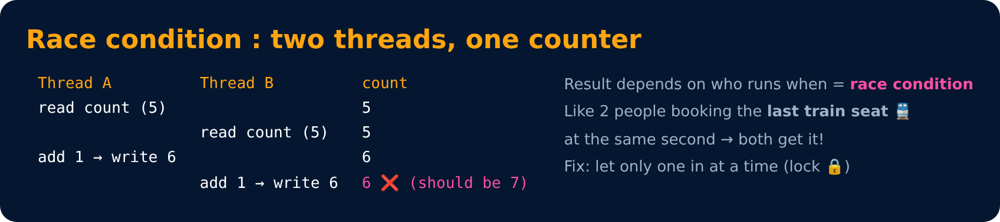
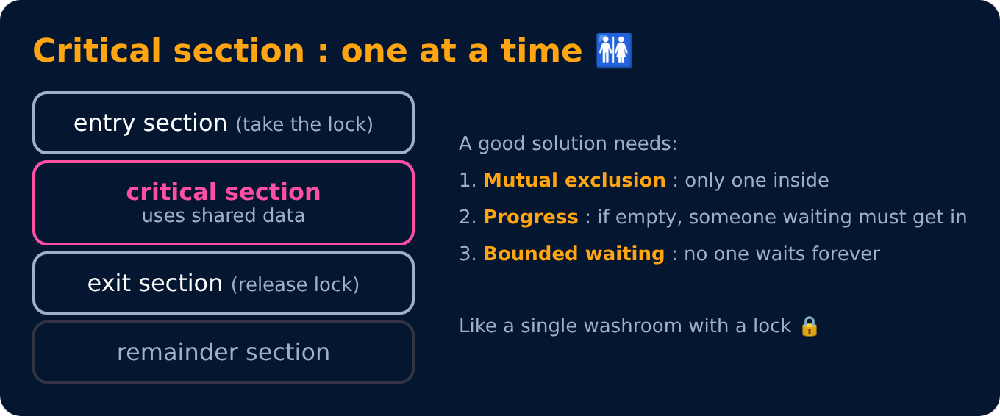

# Race Condition & Critical Section

Level 4 : Synchronization & Deadlock

When processes/threads **share data**, the order in which they run can change the result.

`count++` looks like one step, but the CPU does 3: **read → add → write**. A switch in the middle breaks it.

## Critical section

## Ways to protect a critical section

| Tool | Level | Idea |
|---|---|---|
| Disable interrupts | hardware | no switch can happen (only on single CPU, dangerous) |
| Test-and-Set / Compare-and-Swap | hardware | atomic instruction, used to build locks |
| Peterson's solution | software | 2 processes, uses `flag[]` + `turn` |
| Mutex lock | OS | lock / unlock |
| Semaphore | OS | wait() / signal() counter |
| Monitor | language | lock built into an object (Java `synchronized`) |

---
[← Level 3 : Interview & Revision Questions](../level-3-cpu-scheduling/interview-questions.md) · [Level 4](README.md) · [Home](../README.md) · [Mutex & Semaphore →](02-mutex-and-semaphore.md)
