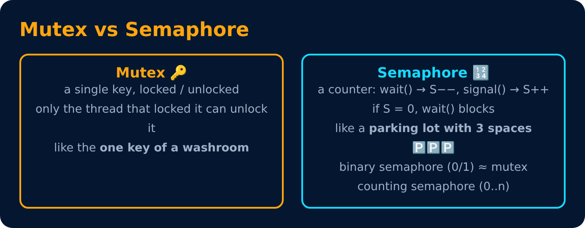

# Mutex & Semaphore

<sub>Level 4 : Synchronization & Deadlock</sub>



```c
// Semaphore operations (atomic)
wait(S)   { while (S <= 0) ; S--; }   // also called P() / down()
signal(S) { S++; }                    // also called V() / up()
```

| | Mutex | Semaphore |
|---|---|---|
| Type | lock object | integer counter |
| Value | locked / unlocked | 0 … n |
| Ownership | only the locker can unlock | any process can signal |
| Use | protect one critical section | control access to n resources, or ordering |

## Busy waiting & spinlock
`while (S <= 0);` keeps the CPU busy doing nothing = **busy waiting**. A lock that does this is a **spinlock**. It is fine on multi-core for very short waits; otherwise the OS puts the process to sleep in a waiting queue.

---
[← Race Condition & Critical Section](01-race-condition-critical-section.md) · [Level 4](README.md) · [Home](../README.md) · [Classic Synchronization Problems →](03-classic-problems.md)
