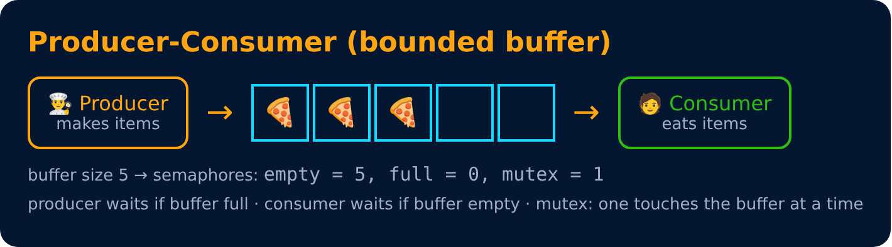
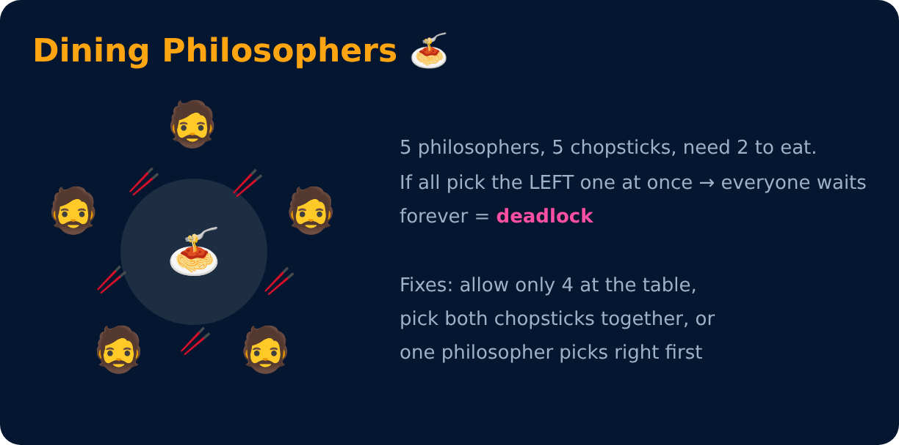

# Classic Synchronization Problems

<sub>Level 4 : Synchronization & Deadlock</sub>

## 1. Producer–Consumer (Bounded Buffer)



```c
// Producer                       // Consumer
wait(empty);                      wait(full);
wait(mutex);                      wait(mutex);
  add item to buffer                remove item from buffer
signal(mutex);                    signal(mutex);
signal(full);                     signal(empty);
```

## 2. Readers–Writers
Many **readers** can read together 📖📖, but a **writer** needs the data alone ✍️. Like a Google Doc: many can view, but editing the same line needs one at a time. Risk: writers may starve if readers keep coming.

## 3. Dining Philosophers



---
[← Mutex & Semaphore](02-mutex-and-semaphore.md) · [Level 4](README.md) · [Home](../README.md) · [Deadlock →](04-deadlock.md)
