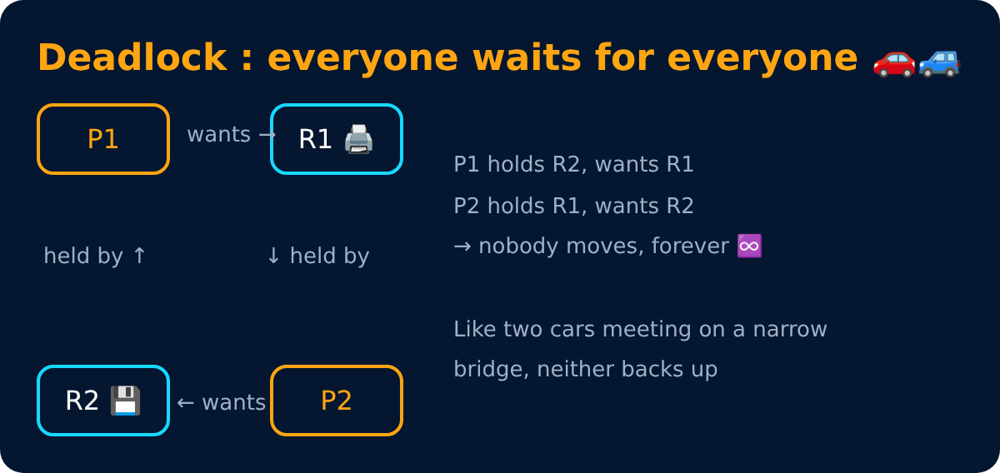
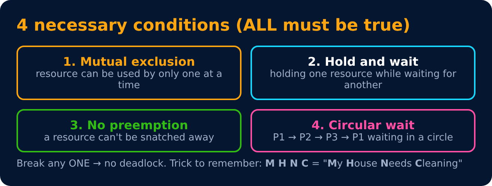
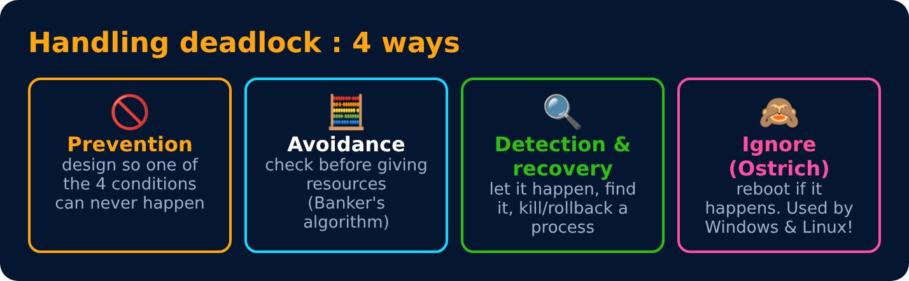
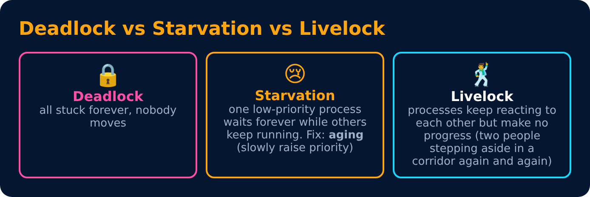

# Deadlock

<sub>Level 4 : Synchronization & Deadlock</sub>



## 4 necessary conditions (Coffman conditions)



## Resource Allocation Graph (RAG)

```
  P1 ──request──▶ R1          circle = process, box = resource
  ▲                │          R → P : resource is allocated (held)
  held            held        P → R : process is requesting
  │                ▼
  R2 ◀──request── P2          a cycle → deadlock (if each resource has 1 instance)
```

- Cycle + single instance of each resource → **deadlock for sure**.
- Cycle + multiple instances → **maybe** deadlock.

## Handling deadlock



### Prevention : break one condition

| Condition | How to break it |
|---|---|
| Mutual exclusion | make resources shareable (not always possible) |
| Hold & wait | ask for all resources at once at the start |
| No preemption | if a request fails, release what you hold |
| Circular wait | number the resources, always request in increasing order ✅ (most practical) |

### Recovery
Kill all deadlocked processes, kill one at a time until the cycle breaks, or preempt resources and **roll back** a process.



---
[← Classic Synchronization Problems](03-classic-problems.md) · [Level 4](README.md) · [Home](../README.md) · [Banker's Algorithm (Deadlock Avoidance) →](05-bankers-algorithm.md)
