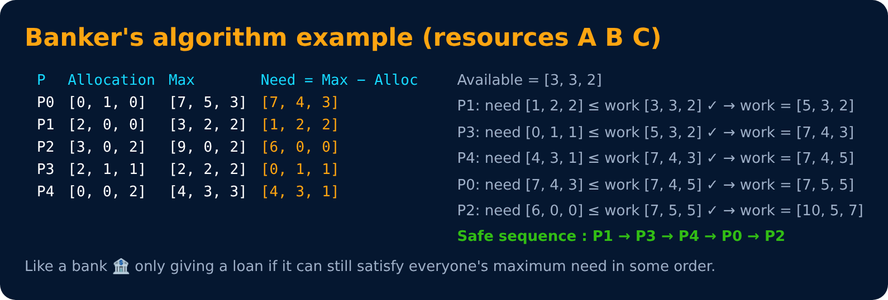

# Banker's Algorithm (Deadlock Avoidance)

Level 4 : Synchronization & Deadlock

Before giving resources, the OS checks: *"If I give this, can everyone still finish in **some** order?"* If yes → **safe state**, give it. If no → make the process wait.

- **Safe state** → no deadlock possible.
- **Unsafe state** → deadlock *may* happen (not guaranteed).

## Steps
1. **Need = Max − Allocation**
2. **Work = Available**
3. Find a process with **Need ≤ Work** → assume it finishes → **Work = Work + its Allocation**
4. Repeat. If all processes finish → safe, and that order is the **safe sequence**.

❌ Downsides : needs max demand in advance, fixed number of processes & resources, so it's rarely used in real OSes, but very popular in exams/interviews.

---
[← Deadlock](04-deadlock.md) · [Level 4](README.md) · [Home](../README.md) · [Level 4 : Interview & Revision Questions →](interview-questions.md)
