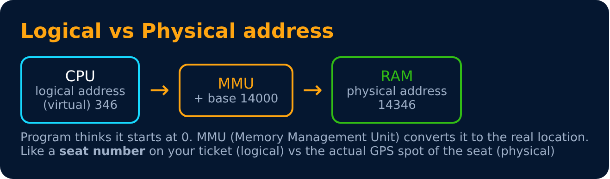
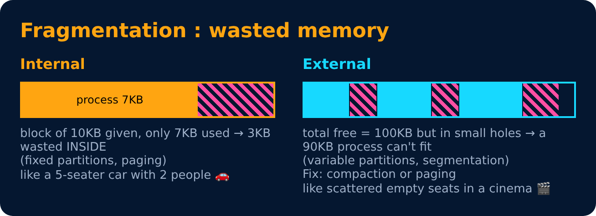

# Memory Basics, Allocation & Fragmentation

<sub>Level 5 : Memory Management</sub>

RAM is limited, and many processes want it. The OS decides **who gets which part**, and keeps processes from touching each other's memory.

## Logical vs physical address



## Memory hierarchy (fast & small → slow & big)

```
 Registers  ⚡ fastest, tiny
 Cache (L1/L2/L3)
 RAM (main memory)
 SSD / Hard disk  🐢 slowest, huge
```

## Contiguous allocation
Each process gets **one continuous block**.

- **Fixed partitioning** : RAM split into fixed blocks → **internal fragmentation**.
- **Variable (dynamic) partitioning** : block = exact size → **external fragmentation** over time.




**Compaction** = shuffle processes together to merge the holes (slow). The better fix: **paging** 👉 next file.

---
[← Level 4 : Interview & Revision Questions](../level-4-synchronization-deadlock/interview-questions.md) · [Level 5](README.md) · [Home](../README.md) · [Paging & Segmentation →](02-paging-and-segmentation.md)
