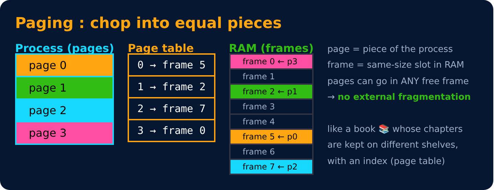
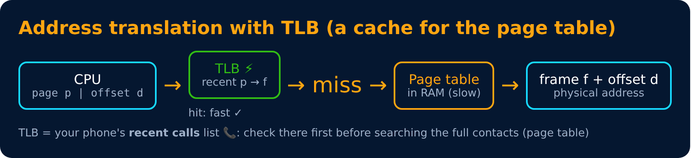
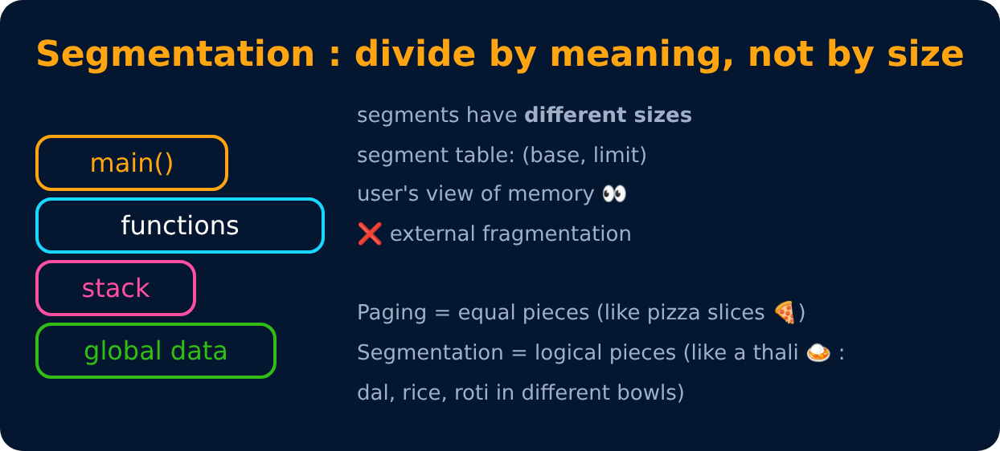

# Paging & Segmentation

<sub>Level 5 : Memory Management</sub>



## Address translation

```
logical address = | page number (p) | offset (d) |
physical address = page_table[p] × frame_size + d
```

**Example:** page size = 1 KB (1024), logical address = 2100
→ p = 2100 / 1024 = **2**, d = 2100 % 1024 = **52**
→ if page 2 is in frame 7 → physical = 7 × 1024 + 52 = **7220**

## TLB (Translation Lookaside Buffer)
Looking up the page table in RAM for every access = 2 memory accesses (slow). The TLB is a tiny, super-fast cache of recent translations.



**Effective Access Time** = hit ratio × (TLB + mem) + (1 − hit ratio) × (TLB + 2 × mem)

## Segmentation



| | Paging | Segmentation |
|---|---|---|
| Size | fixed (pages) | variable (segments) |
| Based on | physical convenience | logical units (code, stack...) |
| Fragmentation | internal (last page) | external |
| Visible to programmer | no | yes |
| Table | page table (frame no.) | segment table (base, limit) |

---
[← Memory Basics, Allocation & Fragmentation](01-memory-basics-and-fragmentation.md) · [Level 5](README.md) · [Home](../README.md) · [Virtual Memory & Demand Paging →](03-virtual-memory.md)
