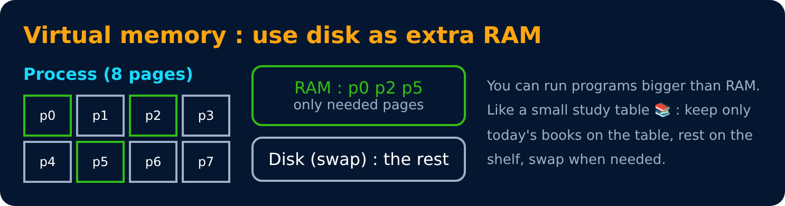
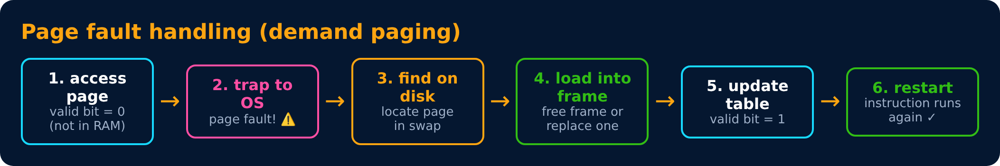
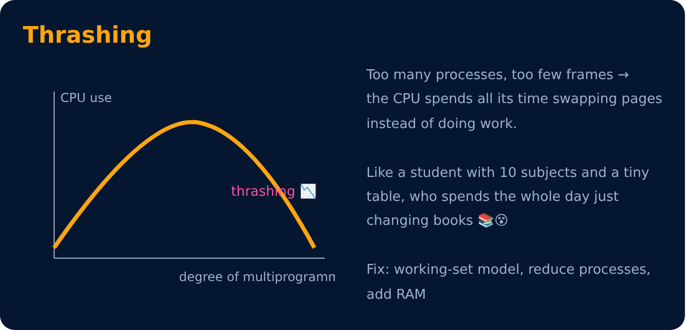

# Virtual Memory & Demand Paging

Level 5 : Memory Management

**Demand paging** : load a page into RAM **only when it's needed** (lazy loading 😴, like Netflix loading only the part of the movie you're watching).

## Page fault
When a process accesses a page that is **not in RAM** (valid bit = 0).

**Swapping** : moving a whole process (or pages) between RAM and disk. The disk area used is the **swap space** (Linux) / **page file** (Windows).

## Thrashing

---
[← Paging & Segmentation](02-paging-and-segmentation.md) · [Level 5](README.md) · [Home](../README.md) · [Page Replacement Algorithms →](04-page-replacement.md)
