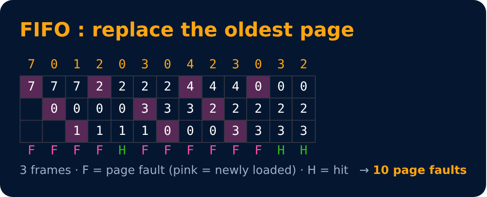
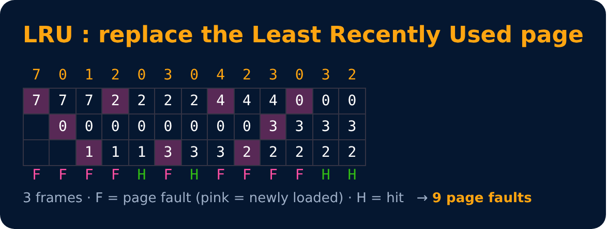
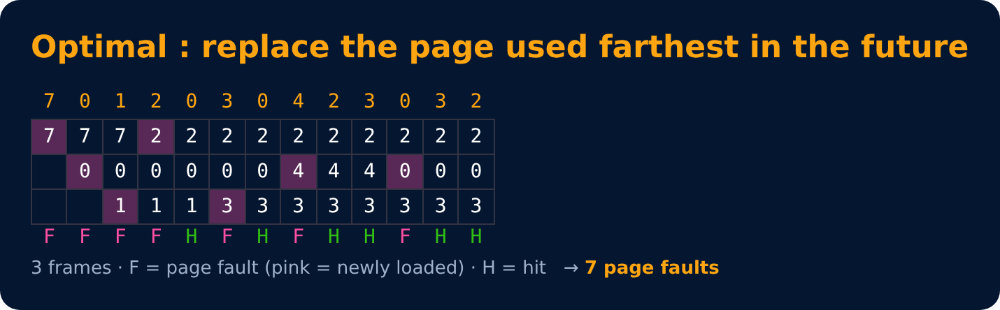

# Page Replacement Algorithms

Level 5 : Memory Management

RAM is full and a page fault happens → which page do we throw out? 🤔

Reference string: **7 0 1 2 0 3 0 4 2 3 0 3 2** with **3 frames**

## 1. FIFO : First In First Out
Remove the page that came **first** (oldest). Like the oldest milk packet 🥛 in the fridge goes first.

## 2. LRU : Least Recently Used
Remove the page **not used for the longest time**. Like clearing the app you haven't opened in months 📱.

## 3. Optimal (OPT / MIN)
Remove the page that will be used **farthest in the future** (or never). Best possible, but needs to know the future 🔮, so it's used only as a benchmark.

| Algorithm | Page faults (this example) | Notes |
|---|---|---|
| FIFO | 10 | simple, suffers Belady's anomaly |
| LRU | 9 | good in practice, needs tracking of use |
| Optimal | 7 | lowest possible, not implementable |

**Hit ratio** = hits / total references. Here for LRU = 4/13.

---
[← Virtual Memory & Demand Paging](03-virtual-memory.md) · [Level 5](README.md) · [Home](../README.md) · [Level 5 : Interview & Revision Questions →](interview-questions.md)
