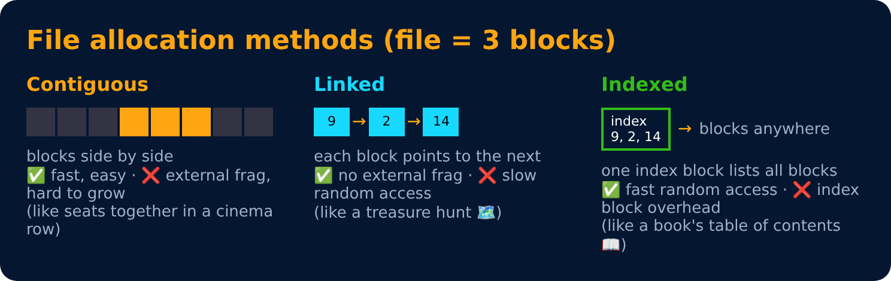

# File Systems

<sub>Level 6 : File Systems & Disk</sub>

A **file system** organizes data on a disk into files and folders, like a library 📚 with sections, shelves and a catalogue.

- **File** : named collection of data. Has attributes: name, type, size, location, permissions, timestamps.
- **Directory** : a special file that lists other files (tree structure: `/home/gagan/notes`).
- **Common file systems** : NTFS (Windows), ext4 (Linux), APFS (macOS), FAT32 (pen drives).

## File allocation methods



## inode (Linux)
Each file has an **inode** storing its metadata (size, owner, permissions, pointers to data blocks), everything except the name. The directory maps **name → inode number**.

## File permissions (Linux)

```
-rwxr-xr--   owner: read write execute | group: read execute | others: read
chmod 754 file.txt   (7=rwx, 5=r-x, 4=r--)
```

---
[← Level 5 : Interview & Revision Questions](../level-5-memory-management/interview-questions.md) · [Level 6](README.md) · [Home](../README.md) · [Disk Scheduling →](02-disk-scheduling.md)
