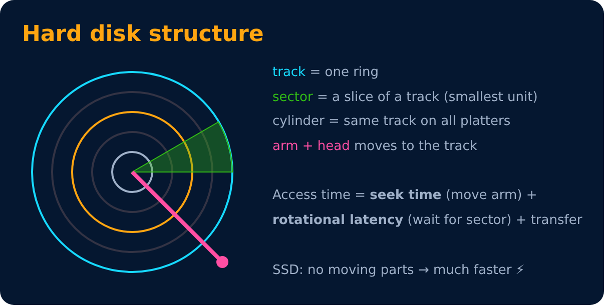
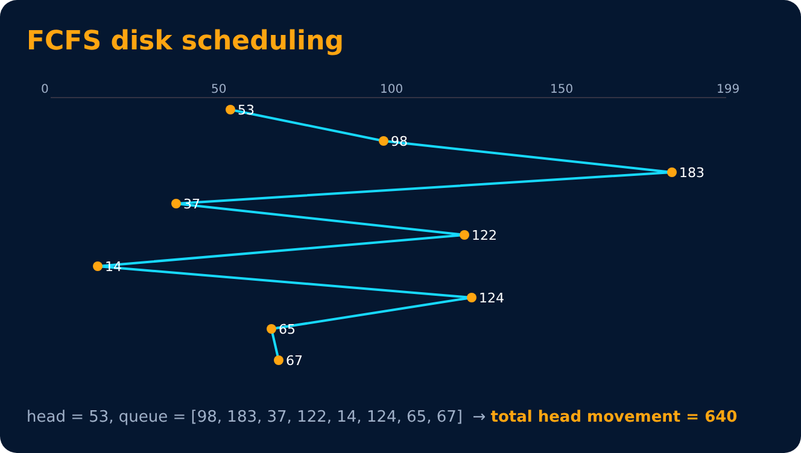
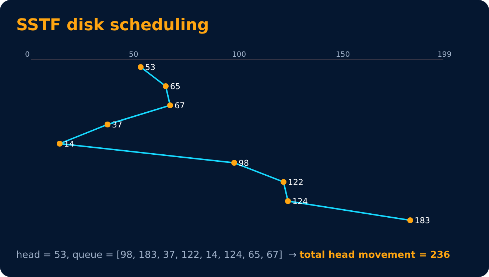
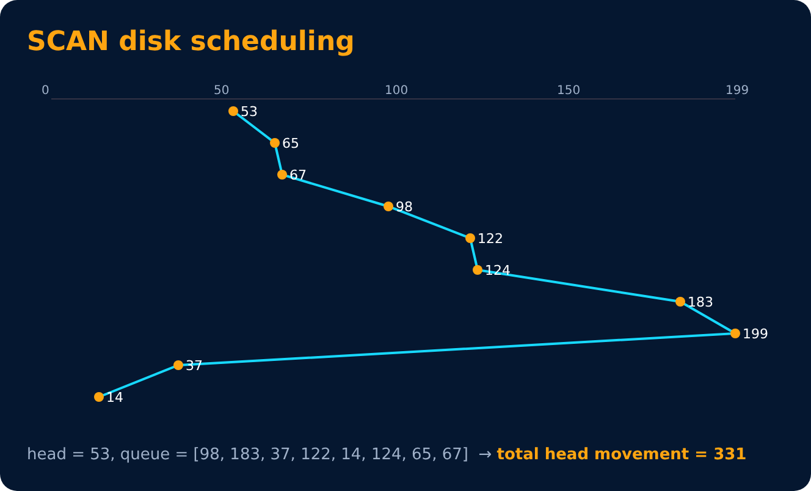
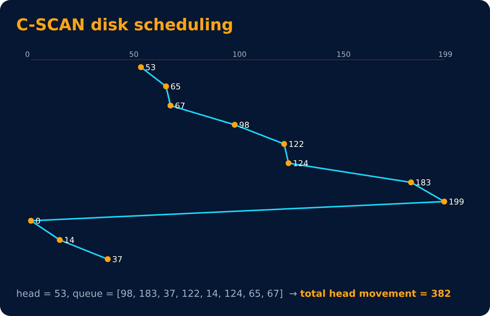
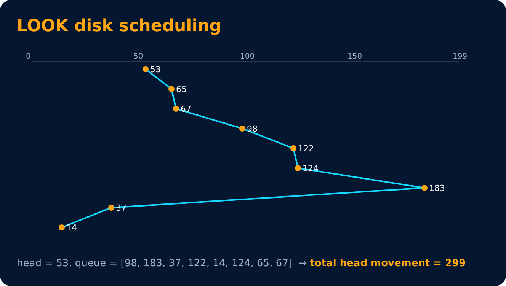
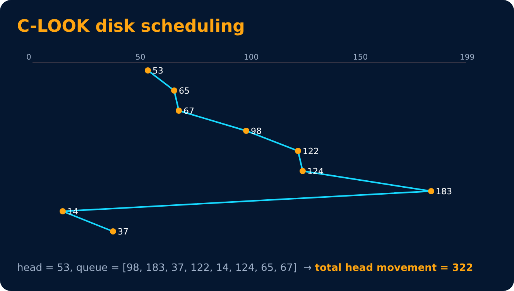

# Disk Scheduling

Level 6 : File Systems & Disk

Seek time is the slowest part, so the OS reorders requests to **reduce head movement**.

**Example used below:** head at **53**, request queue = **[98, 183, 37, 122, 14, 124, 65, 67]**, disk tracks 0–199, head moving towards higher tracks first.

## FCFS : in order of arrival

## SSTF : Shortest Seek Time First (nearest request next)

Can starve far-away requests.

## SCAN (Elevator 🛗) : go to one end, then reverse

## C-SCAN : go to the end, jump back to 0, continue the same way

## LOOK : like SCAN but turns at the last request (not the disk end)

## C-LOOK : like C-SCAN but only up to the last request

| Algorithm | Total movement (this example) | Starvation? |
|---|---|---|
| FCFS | 640 | No |
| SSTF | 236 | Yes |
| SCAN | 331 | No |
| C-SCAN | 382 | No |
| LOOK | 299 | No |
| C-LOOK | 322 | No |

> Exam tip: some books count the C-SCAN jump (199 → 0) and some don't. Here it is counted. Say which you use.

---
[← File Systems](01-file-systems.md) · [Level 6](README.md) · [Home](../README.md) · [RAID, Buffer, Cache & Spooling →](03-raid-buffer-cache-spooling.md)
