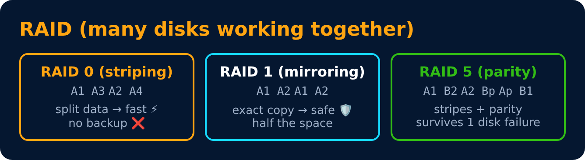
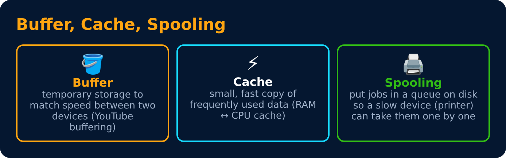

# RAID, Buffer, Cache & Spooling

Level 6 : File Systems & Disk

| RAID | Min disks | Speed | Survives failure | Use |
|---|---|---|---|---|
| 0 | 2 | ⚡⚡ | ❌ | video editing scratch |
| 1 | 2 | read ⚡ | ✅ 1 disk | OS / important data |
| 5 | 3 | ⚡ | ✅ 1 disk | file servers |
| 10 (1+0) | 4 | ⚡⚡ | ✅ | databases |

## DMA (Direct Memory Access)
A DMA controller copies data between a device and RAM **without the CPU** doing each byte. CPU only gets an interrupt when the transfer is done. Like hiring movers 🚚 instead of carrying every box yourself.

---
[← Disk Scheduling](02-disk-scheduling.md) · [Level 6](README.md) · [Home](../README.md) · [Level 6 : Interview & Revision Questions →](interview-questions.md)
