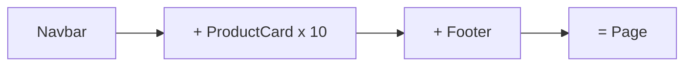

# What is React?

*A JavaScript library for building user interfaces*

- Made by Meta (Facebook). Used by Netflix, Instagram, Airbnb, Swiggy...
- **Component based** - build small pieces (Navbar, Card, Button) and join them like LEGO
- **Declarative** - you describe WHAT the UI should look like, React figures out HOW to update the DOM
- It is a **library**, not a framework - it only handles the UI (routing, data etc. come from other packages)

---
[Level 1 index](README.md) | [All levels](../README.md) | [Why React? →](../level-01-react-basics/02-why-react.md)
