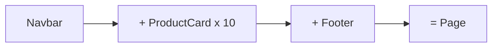

## 📦 Package vs 📚 Library vs 🏗️ Framework

**📦 Package** → any ready-made code you download with **npm**. It's just the **container**, and a library or a framework can come inside it.

```bash
npm install react      # React comes as a package
```

**📚 Library** → code **you call** when you need it. **You are in control.**

```js
import _ from "lodash";
_.sum([1, 2, 3]);   // you decide when to use it
```

> 🧰 Like a **toolbox**: you pick the tool you want. Examples: **React**, Lodash, Axios

**🏗️ Framework** → gives the **structure**, and **it calls your code**. **The framework is in control.**

```js
app.get("/", (req, res) => res.send("Hi"));
// You write the function; Express decides when to run it
```

> 🏠 Like a **house frame**: you fill in the rooms, but the shape is already fixed. Examples: **Express**, Next.js, Angular


# What is React?

*A JavaScript library for building user interfaces*

- Made by Meta (Facebook). Used by Netflix, Instagram, Airbnb, Swiggy...
- **Component based** - build small pieces (Navbar, Card, Button) and join them like LEGO
- **Declarative** - you say WHAT you want on screen, React does the work (see below 👇)
- It is a **library**, not a framework - it only handles the UI (routing, data etc. come from other packages)



## 🗣️ Imperative vs ✨ Declarative

> 🍕 **Ordering food:**
> - **Imperative** → you go into the kitchen and cook it yourself, step by step.
> - **Declarative** → you just tell the waiter "one pizza, please". The kitchen handles the rest.

**🗣️ Imperative** (plain JS) → **you** give every step to change the screen.

```js
const h1 = document.createElement("h1");   // 1. make it
h1.textContent = "Hello";                  // 2. fill it
document.body.appendChild(h1);             // 3. put it on the page
```

**✨ Declarative** (React) → you only describe the **result**. React does the steps.

```jsx
<h1>Hello</h1>
```

> 💡 Imperative = **HOW** to do it. Declarative = **WHAT** you want.

---
[Level 1 index](README.md) | [All levels](../README.md) | [Why React? →](../level-01-react-basics/02-why-react.md)
