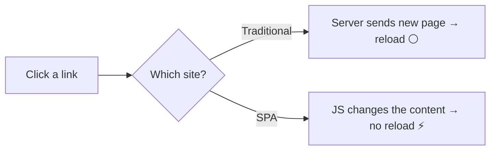

# 📄 SPA - Single Page Application

## 🐢 Traditional website

- Every click → the server sends a **NEW HTML page**
- Full page reload → **white flash** ⚪

## ⚡ React SPA

- Only **ONE HTML page** (`index.html`)
- JavaScript **swaps the content** on the screen
- No reload → feels like an **app** 📱

> 📖 Like a **book vs a whiteboard**: a traditional site turns to a new page every time, an SPA just erases and redraws part of the same board.

> 💡 **Examples:** Gmail, Instagram web, Netflix - they all feel instant because they are SPAs.

---
[← Why React?](../level-01-react-basics/02-why-react.md) | [Level 1 index](README.md) | [All levels](../README.md) | [Virtual DOM →](../level-01-react-basics/04-virtual-dom.md)
